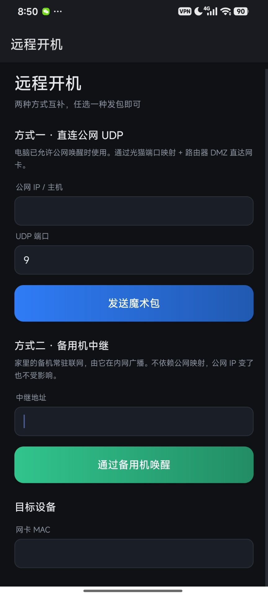
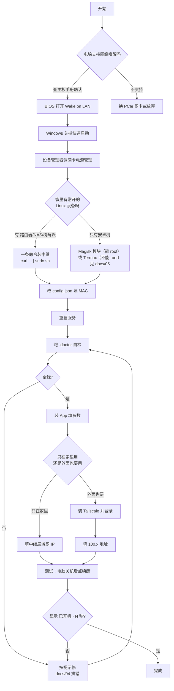
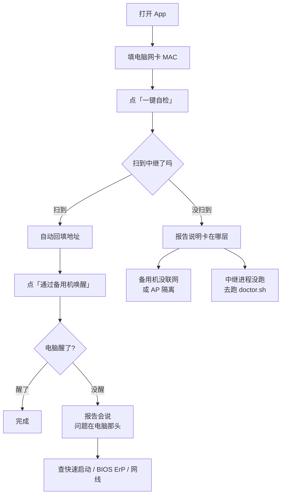

# WOL Relay · 人在外面，一个按钮把家里的电脑开起来

**发完包会真的去确认「醒没醒」** —— 不是「已广播，大概 10~20 秒起来」，
是 **「已开机 · 23 秒」**。

两种装法，**不需要 root**：

| | 装在哪 | 需要 root |
|---|---|---|
| **裸二进制**（推荐） | 路由器 / NAS / 树莓派 / 软路由 / 旧笔记本，任何常开的 Linux | **不需要** |
| **Magisk 模块** | 一台能 root 的闲置安卓机 | 需要 |

一条命令装好（自动识别架构和启动方式，配好开机自启）：

```bash
curl -fsSL https://raw.githubusercontent.com/huangJUN6666/wol-relay-android/main/scripts/install.sh | sudo sh
```

作者：**神仙道**　QQ：**1974147300**

<p align="center">
  
</p>

<p align="center"><sub>配套 App 主界面。两种方式并行，哪条通走哪条；中继地址可以填多个，在家走局域网、在外走 Tailscale。</sub></p>

<p align="center">
  <a href="https://github.com/huangJUN6666/wol-relay-android/releases/latest"></a>
  
  
</p>

---

## 这东西解决什么问题

Wake-on-LAN 本身很简单，往局域网广播一个魔术包就行。麻烦在于两件事：

1. **你在外面，广播进不了家门。**
2. **包发出去了，但没人告诉你电脑到底醒没醒。**

第一件事常见的绕法有三种：

- 路由器端口映射 + DDNS —— 要公网 IP，多数宽带已经没有了
- 路由器刷 OpenWrt 跑 WOL 插件 —— 得先能刷，还得路由器支持
- 电脑装个联网插座 —— 电是来了，但断电关机对硬盘不友好

这个项目的做法是：**留一台常开的设备在家，让它替你在局域网里发这个包。**

第二件事是**所有 WOL 工具都不做的那一环**，也是这个项目和它们的区别：

```
  你在外面                    家里
 ┌─────────┐              ┌──────────────┐        ┌──────────┐
 │  手机   │  ① 请求      │  中继        │  ② 广播 │  电脑    │
 │  App    │ ───────────► │  (常开的设备) │ ──────► │ 网卡上电 │
 └─────────┘  Tailscale   └──────────────┘  UDP 9  └──────────┘
      ▲                          │                      │
      └──── ④ 已开机 · 23 秒 ─────┘  ③ 查 ARP + 探端口 ◄─┘
```

中继在发完包之后不会就此收工，它会继续盯：

1. **查 ARP**（2~5 秒就有）—— 网卡上电了，比系统起来早十几秒
2. **探端口**（445 / 3389 / 22 / 80 / 443，任一通即算醒）—— 系统真的起来了
3. 两者都没有才扫网段兜底，且**必须回查 ARP 核验 MAC**

所以 App 上显示的不是「已广播」，而是 **「已开机 · 23 秒」**。

**没醒的时候它也不只说「超时」**，而是会告诉你是哪一侧的问题：

- ARP 里从头到尾没出现那个 MAC → 网络侧（不同网段、网线没插、路由器没转发）
- ARP 出现了但端口一直连不上 → 电脑侧（BIOS 设置、Windows 快速启动）
- 3 秒内就通了 → 它本来就开着，不会谎报「已开机 · 1 秒」

## 跟其他方案比，区别在哪

GitHub 上同类项目基本都是用 Termux 跑个 Python 脚本。能跑，但撑不住，而且只会告诉你「包发出去了」：

| | 常见的 Termux 脚本 | 本项目 |
|---|---|---|
| **确认醒没醒** | 无，只说「已发送」 | **ARP + TCP 双重确认，报「已开机 · N 秒」** |
| **失败归因** | 无 | **区分网络侧 / 电脑侧** |
| **多台设备** | 一个脚本一台机 | **一台中继管多台，`/wake?name=nas`** |
| **装在哪** | 只能安卓 | **路由器 / NAS / 树莓派 / 软路由 / 安卓，全都能** |
| **需要 root** | 否 | **否**（Magisk 模块是可选方案） |
| 进程存活 | 普通 App，被厂商省电策略清掉 | systemd / procd 托管，或 Magisk 模块 root 常驻 |
| 开机自启 | 靠 Termux:Boot，经常拉不起来 | 系统级服务，或模块 service.sh |
| 挂掉恢复 | 手动重启 | 自动重拉，连续崩就退避（6s→12s→…→300s） |
| 换网段/搬家 | 手改广播地址 | 自动算本网段广播地址，多网卡全发 |
| 挂着 VPN | 包发进隧道，电脑不醒 | 认隧道网卡（tailscale/wg/tun…）直接跳过 |

**为什么唤醒确认用 TCP 不用 ping**：ICMP 要 raw socket，非 root 跑不了。
这一条直接决定了能不能做到「不需要 root」—— 用 ping 的话，
确认功能就只能 root 用，那免 root 版就残了一半。

## 需要什么

**必须在手边的：**

- **一台常开的 Linux 设备** —— 路由器（OpenWrt/爱快）、NAS、树莓派、软路由、旧笔记本，任选一台
  （只有安卓机也行，能 root 用 Magisk 模块，不能 root 用 Termux 但会掉）
- 家里那台电脑，**有线网卡**，主板 BIOS 支持网络唤醒
- 家里的路由器管理密码

**软件：**

- 中继：不需要额外依赖，一个静态二进制
- 手机端 App：本仓库 Releases 里的 `WOL-Relay-App-v2.2.1.apk`
- 外网访问（可选）：Tailscale

## 整体步骤



## 两条路怎么选

| | 方式一 · 直连公网 | 方式二 · 中继 |
|---|---|---|
| 需要公网 IP | 要 | 不要 |
| 需要端口映射 | 要 | 不要 |
| 公网 IP 变了 | 改配置 | 不受影响 |
| 需要备用机 | 不要 | 要 |
| 成功率 | 看运营商 | 高 |

**如果家用宽带已经没有公网 IPv4（现在很常见），方式一直接不用考虑，走方式二。**

## 快速开始

```bash
# 依赖：go 1.21+、python3（打 zip 用）
bash scripts/build-module.sh
# 产物：dist/wol-relay-v2.2.1.zip

# 推到手机并刷入
adb push dist/wol-relay-v2.2.1.zip /sdcard/Download/
# 手机上打开 Magisk → 模块 → 从本地安装 → 选这个 zip

# 改配置
su -c 'vi /data/adb/wol-relay/config.json'
# devices[0].mac 改成目标电脑的网卡地址，多台就往后加

# 重启，然后自检
adb reboot
su -c sh /data/adb/modules/wol-relay/doctor.sh
```

App 那边：

```bash
cp build.env.example build.env   # 填本机 SDK / JDK 路径
bash scripts/build-apk.sh
# 产物：dist/WOL-Relay-App-v2.2.1.apk
```

### 想自己发一份到 GitHub

仓库里带了两个脚本，只用 `api.github.com`，不碰 `github.com` 主站，
所以挂着不稳定的代理也能传完。

```bash
export GH_TOKEN=ghp_xxxxxxxx      # classic PAT 勾 repo 即可

python scripts/push-via-api.py    # 建仓库 + 传全部文件
python scripts/publish-release.py # 打 tag + 发 Release + 传 dist/ 产物
```

`GH_TOKEN` 用完去 Settings → Developer settings → Personal access tokens
撤销，别留在 shell 历史里。

如果本机 `git push` 能通，也可以走常规路子：

```bash
bash scripts/push-github.sh 你的用户名 wol-relay-android
```

## App 怎么用

装完什么都不用配，界面自己会带你走：



自检做的事，一句话讲完：**扫本机 /24 网段，找到所有在 8080 上回 `/status` 的设备，
逐个核对 MAC 是否跟 App 里填的一致、是否开了鉴权，最后给一句结论告诉你该点哪个按钮。**

找不到中继的时候它不会只说「失败」，会分四种情况告诉你去哪查：

| 现象 | 说明 |
|---|---|
| 中继连不上 | 备用机没开机、没连同一 WiFi，或路由器开了 AP 隔离 |
| 中继通了，一个包没发出去 | 中继自己广播不出去，上备用机跑 `doctor.sh` 看广播目标 |
| 中继回了 403 | 令牌不对，抄 `config.json` 里的 token |
| 发包成功但电脑没醒 | 问题在电脑那头，查快速启动 / BIOS ErP / 网线 |

中继地址填法很松，`192.168.1.50`、`192.168.1.50:8080`、`http://192.168.1.50:8080`
都认，不用写 `/wake`，端口不写就按 8080 算。

## 文档

| 文档 | 讲什么 |
|---|---|
| [docs/01-电脑端设置.md](docs/01-电脑端设置.md) | BIOS、Windows 快速启动、网卡电源管理，逐项截图级说明 |
| [docs/02-路由器设置.md](docs/02-路由器设置.md) | 光猫路由模式判断、端口映射、DMZ、AP 隔离，含各种常见型号 |
| [docs/03-备用机部署.md](docs/03-备用机部署.md) | 刷模块、改配置、Tailscale、自检 |
| [docs/04-排错.md](docs/04-排错.md) | 症状对照表，一条一条排查 |
| [docs/05-没有root怎么办.md](docs/05-没有root怎么办.md) | Termux 替代方案，以及它的局限 |
| [docs/06-适合哪些设备.md](docs/06-适合哪些设备.md) | 备用机、电脑、路由器分别什么要求 |
| [CHANGELOG.md](CHANGELOG.md) | 每个版本改了什么，以及踩过的坑 |

## 仓库结构

```
wol-relay-android/
├── module/              Magisk 模块（service.sh 守护 + doctor.sh 自检）
│   ├── service.sh       开机自启、进程守护、隧道巡检
│   ├── customize.sh     安装时执行，首次装自动生成 config.json
│   ├── doctor.sh        五层诊断，输出自动打码
│   ├── module.prop      模块元信息
│   └── META-INF/        Magisk 安装脚本
├── relay/               Go 中继服务
│   ├── main.go          HTTP 服务 + 魔术包广播 + 自动算广播地址
│   └── config.example.json
├── android/app/         App 源码（单 Activity，无第三方库）
│   └── src/com/wol/remote/MainActivity.java
├── scripts/
│   ├── build-module.sh   交叉编译 + 打模块 zip
│   ├── build-apk.sh      手工打包 APK（不用 Gradle）
│   ├── check-version.sh  检查五处版本号是否一致，提交前跑
│   ├── push-github.sh    走 git push 一键上传（需要 gh 登录）
│   ├── push-via-api.py   走 REST API 上传（只需 PAT，绕开主站）
│   ├── publish-release.py 打 tag、发 Release、传产物
│   └── release.sh        本地打 tag 版
├── docs/                六篇文档 + screenshots/（界面截图）
└── .github/workflows/   CI 构建与 Release
```

## 已知限制

- **Tailscale 在安卓上冷启动要 40~70 秒**。刚开机那一两分钟内点唤醒可能会失败，等一会儿再点。
- **root shell 看不到 `tailscale0` 网卡**，因为 VPN 在 App 自己的命名空间。判断连接状态要查路由表或直接 ping，不能查网卡。
- **NAT 回环**：在自己家的网络里往自己的公网 IP 发包，运营商会把包 SNAT 回来，看起来成功但走的不是真正的公网路径。所以方式一必须去别人家或公司 WiFi 下测才算数。
- **Windows 快速启动是最大的坑**。默认开着，关机其实是休眠，网卡断电，WOL 必然失败。这一条排在所有排错的第一位。
- 只支持 IPv4。IPv6 下的唤醒没做。

## 两个花了我一晚上的坑

记在这里，省得后来的人再踩一遍。

**一、Android/Linux 默认不允许往广播地址发包。** 内核层面 `SO_BROADCAST` 不打开，
`sendto` 直接返回 `EACCES permission denied`。Go 的 `net.Dial` 不会替你开，
必须自己接管 socket：用 `net.Dialer.Control` 拿到 fd，`setsockopt` 把
`SO_BROADCAST` 置 1，然后再连、再写。这个改完才真正能发出去。

**二、挂了代理或 VPN 时，广播地址会算错。** Tailscale 一上线就抢默认路由，
如果按"默认出口网卡"去算广播，算出来是 `100.x` 隧道网段的广播地址——
魔术包从隧道出去，绕一圈不知道去哪了，家里电脑当然不醒，
而日志上写着"发送成功"。

现在的做法是遍历所有物理网卡（`FlagUp`、非 loopback），
名字以 `tun/tap/tailscale/wg/ppp/ipsec/utun` 开头的一律跳过，
`100.64.0.0/10` 的地址也跳过，剩下的每块网卡各算一个定向广播，全部发一遍。
多网卡（比如 WiFi + USB 网卡同时在）也能覆盖到。跑 `doctor.sh` 会把这层单独打出来。

## 许可

MIT，见 [LICENSE](LICENSE)。

用出问题欢迎提 issue，附上 `doctor.sh` 的输出（里面的 MAC 和 IP 会自己打码）。
