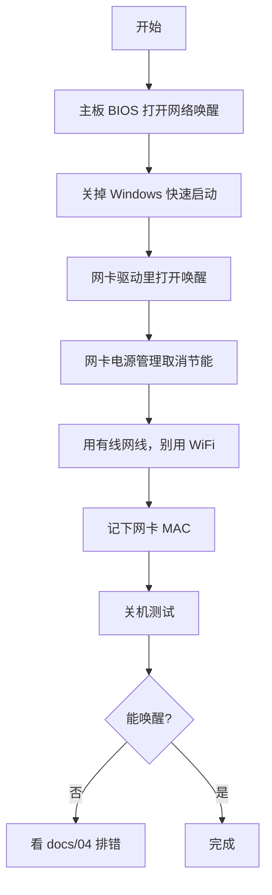
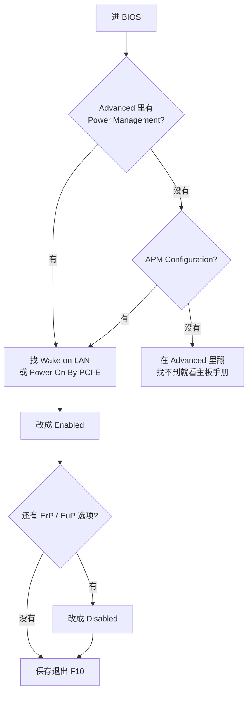
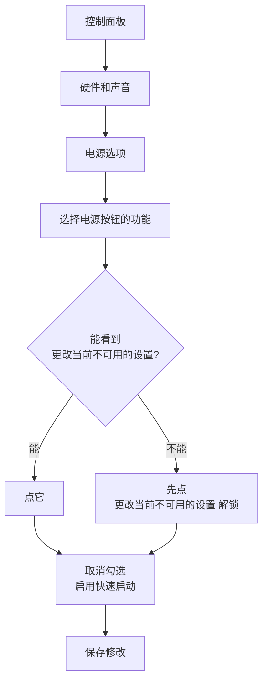
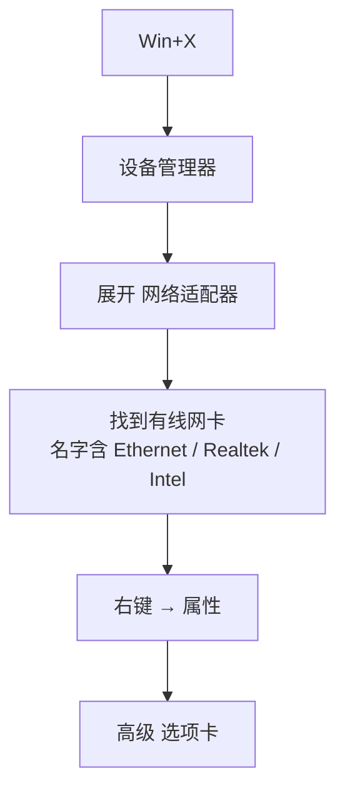
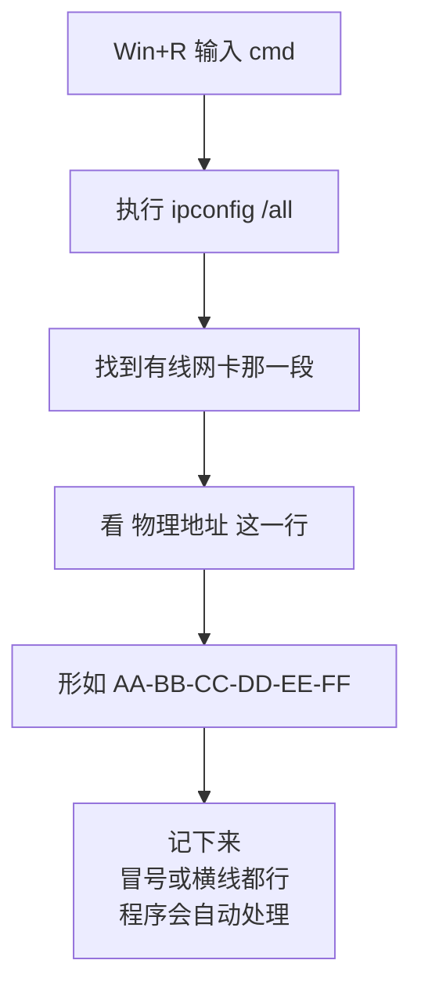

# 一、电脑端设置

WOL 失败的原因里，**七成以上出在电脑这边**，而且是最容易被忽略的地方。按顺序做完这四步再往下走。

作者：神仙道vq　QQ：1974147300

---

## 总流程



---

## 第一步 · BIOS 里打开网络唤醒

**这一步不做，后面全白费。** 关机后网卡要靠主板的待机电供电才能听广播。

### 怎么进 BIOS

开机狂按这几个键之一：

| 主板品牌 | 按键 |
|---|---|
| 华硕 ASUS | `Del` 或 `F2` |
| 微星 MSI | `Del` |
| 技嘉 Gigabyte | `Del` |
| 华擎 ASRock | `F2` 或 `Del` |
| 联想 Lenovo | `F1` 或 `F2`，部分机型是侧边小孔 |
| 戴尔 Dell | `F2` |
| 惠普 HP | `F10` 或 `Esc` |

笔记本可能还要配合 `Fn`。

### 找什么选项

各家叫法不一样，位置一般在 **Advanced** 或 **Power Management** 下面。按这个顺序找：



**常见选项名对照：**

| 看到这个 | 意思 | 设成 |
|---|---|---|
| `Wake on LAN` / `WOL` | 网络唤醒 | Enabled |
| `Power On By PCI-E` | PCIe 设备唤醒 | Enabled |
| `Resume By LAN` / `Wake Up On LAN` | 同上，老主板叫法 | Enabled |
| `Power On By PCIe/PCI` | 同上 | Enabled |
| `ErP` / `EuP` / `ErP Ready` | **深度节能，会切断待机电** | **Disabled** |
| `Deep Sleep` / `Deep S5` | 同上 | **Disabled** |
| `Power On By Onboard LAN` | 同 WOL | Enabled |

> **ErP 是最隐蔽的杀手。** 很多主板默认开 ErP 省电（欧盟能效要求），一开就等于关机后彻底断电，网卡根本没电听广播。改 WOL 的同时一定要检查 ErP。

### 特殊情况

**网卡是 Realtek 2.5G（8125/8126）**：这类网卡在部分主板上需要额外打开 `Power On By PCIe` 并且关掉 `ErP`，两个缺一不可。

**主板太老没这选项**：如果主板是 2010 年之前的，可能真的不支持。插一块支持 WOL 的 PCIe 网卡（Intel i210/i219 之类）可以解决。

**笔记本**：部分笔记本的 WOL 只在「接电源」时有效，用电池时会禁用。测试时插上电源。

---

## 第二步 · 关掉 Windows 快速启动

**这是 Windows 上最高频的杀手，也是最多人栽的地方。**

「快速启动」听起来是让开机变快，实际做法是：**关机时把系统内核休眠到硬盘，只保留最低功耗**。这个状态下网卡是断电的，WOL 收不到任何东西。

所以你以为的「关机」，其实是「休眠」。

### 关掉它



具体路径（Win10 / Win11 通用）：

1. `Win + R` → 输入 `control` → 回车
2. 硬件和声音 → 电源选项
3. 左侧「选择电源按钮的功能」
4. 点「更改当前不可用的设置」（需要管理员）
5. **取消勾选「启用快速启动(推荐)」**
6. 保存修改

### 验证一下有没有关掉

管理员 CMD 里执行：

```cmd
powercfg /a
```

应该能看到 **「休眠」已禁用**，或者在可用睡眠状态里没有「休眠」。

如果还显示休眠可用，说明没关干净，再执行一次：

```cmd
powercfg /h off
```

> **副作用**：关掉快速启动后，开机大约会慢 3~8 秒（取决于硬盘）。这是必须付的代价。
>
> **另一个副作用**：`powercfg /h off` 会同时删掉休眠文件，如果你用休眠功能要注意。

### 顺带确认：关机方式

关掉快速启动后，**「关机」才是真关机**。但还有两个坑：

- **睡眠（S3）和关机（S5）是两回事**，WOL 一般两种都能唤醒，但 BIOS 里可能有单独开关。
- **不要用「重启」代替关机测试**。重启不经过 S5 状态，测不出 WOL 是否有效。

---

## 第三步 · 网卡驱动里打开唤醒

### 找到网卡



**怎么认出有线网卡**：名字里通常有 `Ethernet`、`GbE`、`Realtek PCIe`、`Intel(R) Ethernet`。带 `Wi-Fi`、`Wireless`、`802.11` 的是无线网卡，不是它。

### 高级选项卡里要改的项

不同驱动叫法不一样，找这些关键词，**全部设为「已启用」**：

| 选项名 | 说明 |
|---|---|
| `Wake on Magic Packet` | **最关键的一项**，收到魔术包就唤醒 |
| `Wake on Pattern Match` | 收到特定模式包唤醒，可以一起开 |
| `Shutdown Wake-On-Lan` | 关机状态下也能唤醒，**务必要开** |
| `Wake on LAN` | 老驱动的叫法 |
| `魔术封包唤醒` | 中文驱动叫法 |

> `Shutdown Wake-On-Lan` 这项特别重要。有些网卡默认只允许从「睡眠」唤醒，不允许从「关机」唤醒。**你要的是关机唤醒，这项必须开。**

### 电源管理选项卡

切到「电源管理」选项卡，**三项全勾**：

- ☑ 允许计算机关闭此设备以节约电源
- ☑ 允许此设备唤醒计算机
- ☑ **只允许幻数据包唤醒计算机**

第二项如果灰掉不能勾，说明 BIOS 那步没做对，回去检查 WOL 和 ErP。

---

## 第四步 · 记下 MAC 地址

WOL 靠 MAC 定位网卡，不是靠 IP。



命令输出里找到你那张有线网卡（描述里有 Ethernet），看 **物理地址**：

```
以太网适配器 以太网:

   描述. . . . . . . . . . . . . . : Realtek PCIe GbE Family Controller
   物理地址. . . . . . . . . . . . : AA-BB-CC-DD-EE-FF
   IPv4 地址 . . . . . . . . . . . : 192.168.1.23
```

**注意认准网卡**：如果电脑同时有 WiFi 和网线，`ipconfig /all` 里会有好几段。要的是「以太网适配器」那段的物理地址，别抄成 WiFi 的。

> **为什么必须是有线网卡**：WOL 标准要求网卡在关机时仍由待机电供电监听。WiFi 网卡在关机后基本都断电了，绝大多数笔记本的 WiFi 唤醒不可靠。

### 顺手确认网卡支持 WOL

```cmd
powercfg /devicequery wake_armed
```

如果列出了你的网卡名，说明唤醒已经启用。没有的话，回第三步检查。

---

## 检查清单

做完打个勾：

- [ ] BIOS 里 `Wake on LAN` / `Power On By PCI-E` = Enabled
- [ ] BIOS 里 `ErP` / `EuP` = Disabled
- [ ] Windows「快速启动」已取消勾选
- [ ] `powercfg /h off` 已执行（可选，但更保险）
- [ ] 网卡高级里 `Wake on Magic Packet` = Enabled
- [ ] 网卡高级里 `Shutdown Wake-On-Lan` = Enabled
- [ ] 电源管理里三项全勾
- [ ] `powercfg /devicequery wake_armed` 能看到网卡
- [ ] 记下了有线网卡的 MAC
- [ ] 电脑插的是**网线**，不是 WiFi
- [ ] 路由器那头的网线灯在关机后还亮着（灯不亮说明待机电没供上）

最后一条很好用：**关机后看网口灯**。灯亮 = 网卡有电在听；灯灭 = 白折腾，回去查 ErP。

---

下一步 → [02-路由器设置.md](02-路由器设置.md)
