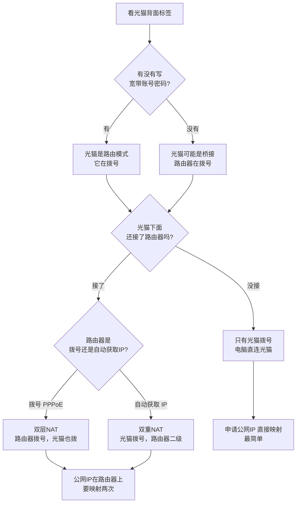
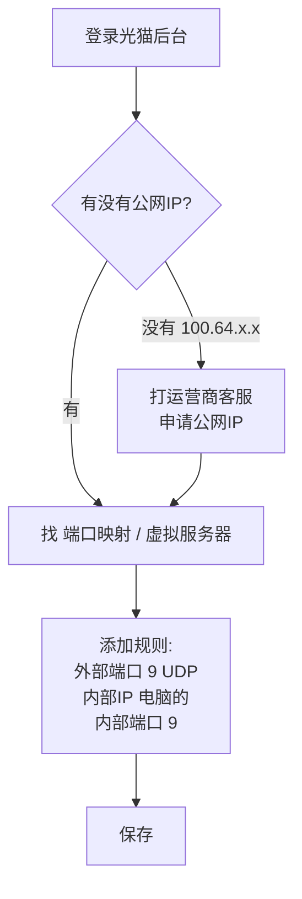
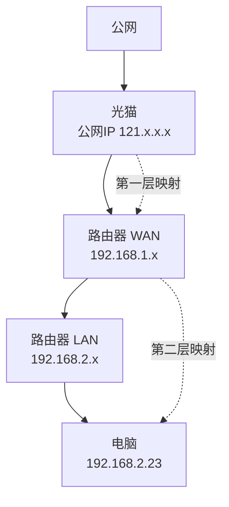
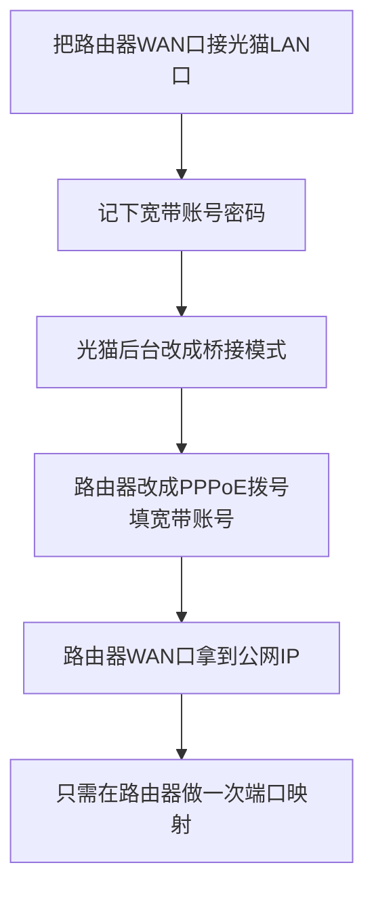
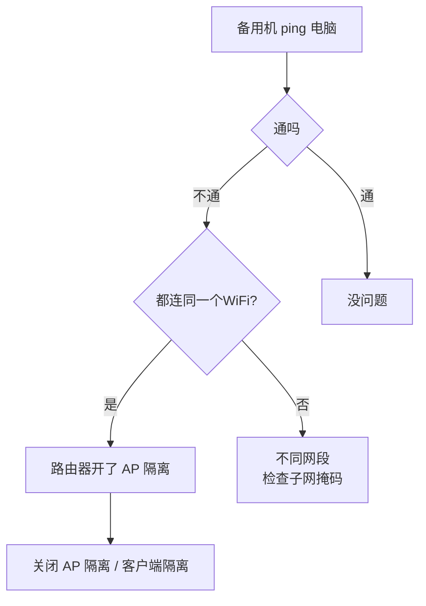
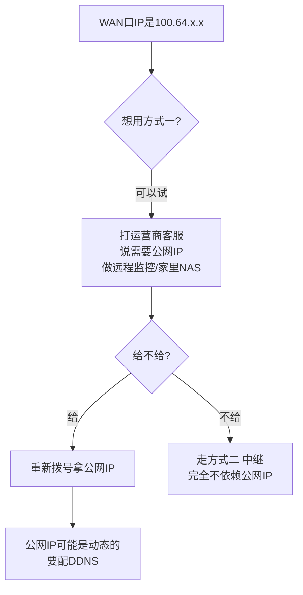

# 二、路由器与光猫设置

这块是**最容易卡住人的地方**，因为每个家庭的网络拓扑都不一样。

先说结论：**如果你用方式二（备用机中继），路由器基本不用动。** 只有走方式一（公网直连）才需要折腾下面的东西。

作者：神仙道vq　QQ：1974147300

---

## 先搞清楚你家网络长什么样



### 怎么判断

**方法一：看光猫标签**

光猫背面通常贴着一张纸，写着「宽带账号 / 宽带密码」。**有的说明光猫在拨号（路由模式）**，没有的可能是桥接。

**方法二：查电脑拿到的网关**

管理员 CMD：

```cmd
ipconfig
```

看「默认网关」：

| 网关地址 | 说明 |
|---|---|
| `192.168.1.1` | 一般是路由器，也可能光猫 |
| `192.168.0.1` | 同上 |
| `192.168.100.1` | 光猫常见（电信） |
| `192.168.101.1` | 光猫常见（联通） |
| `192.168.1.1` 且 IP 是 `192.168.1.x` | 只有一层 NAT，好办 |

**方法三：查光猫和路由器的 WAN 口 IP**

登录路由器后台，看 WAN 口拿到的 IP：

- 拿到 `100.64.x.x` ~ `100.127.x.x`：**这是运营商级 NAT（CGNAT），没有公网 IP，方式一直接放弃**
- 拿到 `10.x.x.x` / `172.16~31.x.x` / `192.168.x.x`：**上层还有一层 NAT，是双重 NAT**
- 拿到 `1.x` / `27.x` / `36.x` / `42.x` / `58.x` / `61.x` / `101.x` / `113.x` / `116.x` / `117.x` / `118.x` / `119.x` / `120.x` / `121.x` / `122.x` / `123.x` / `124.x` / `125.x` / `171.x` / `175.x` / `180.x` / `182.x` / `183.x` / `202.x` / `203.x` / `210.x` / `211.x` / `218.x` / `219.x` / `220.x` / `221.x` / `222.x` / `223.x`：这是公网 IP

> **`100.64.x.x` 这个段一定要记住。** 它长得像公网 IP，其实是运营商的大内网（CGNAT），电信联通移动的宽带现在大量用这个。看到它就是没公网 IP，怎么映射都没用。

---

## 情况一 · 只有光猫，没有额外路由器

最简单的情况。光猫拨号，电脑直连光猫。



### 光猫后台怎么进

看光猫背面标签上的管理地址，通常是：

- 电信：`192.168.1.1` 或 `192.168.100.1`
- 联通：`192.168.1.1` 或 `192.168.101.1`
- 移动：`192.168.1.1`

账号密码也在标签上，普通用户一般是 `useradmin`，超级管理员（telecomadmin / CUAdmin / CMCCAdmin）需要自己查，网上搜「你所在省份 + 光猫型号 + 超级密码」。

> 普通用户的界面经常不给端口映射权限，需要超级管理员账号。这是运营商故意限制的。

### 加端口映射

界面里叫法不一：`端口映射`、`虚拟服务器`、`NAT 设置`、`Port Forwarding`、`Virtual Server`。

加一条：

| 字段 | 填什么 |
|---|---|
| 应用名 / 名称 | `WOL` |
| 外部端口 | `9`（或 `7`、`40000`，有些光猫不让用 9） |
| 内部端口 | 同上，要和外部一致 |
| 内部 IP | 电脑的局域网 IP，如 `192.168.1.23` |
| 协议 | **UDP**（不是 TCP） |

**协议选 UDP 这点经常被忽略。** 魔术包是 UDP，选成 TCP 映射等于没开。

### 让电脑 IP 固定下来

映射填的是 IP，如果电脑 IP 变了映射就失效。两个办法：

**办法一：路由器里做 DHCP 静态绑定（推荐）**

找到 `DHCP 静态分配`、`地址保留`、`IP-MAC 绑定`，把电脑的 MAC 和想要的 IP 绑死。

**办法二：电脑上设静态 IP**

网络适配器 → IPv4 属性 → 手动填 IP / 掩码 / 网关 / DNS。缺点是换网络环境要改回来。

---

## 情况二 · 光猫 + 路由器（双重 NAT）

这时候公网 IP 在光猫上，路由器又做了一层 NAT，需要**映射两次**。



### 两个选择

**选择 A：光猫改桥接，路由器拨号（推荐）**

一次映射搞定，网络也更干净。



光猫改桥接：登录超级管理员 → 网络 → 宽带设置 → 连接模式改成「桥接」→ 保存重启。

改完后光猫就不拨号了，路由器来拨。**注意：宽带账号密码一定要先记下来**，改之前的原件页面上能看到。

**选择 B：保持双重 NAT，映射两次**

不想动光猫的话，也可以，就是麻烦点。

**第一层：光猫上映射到路由器**

| 字段 | 填什么 |
|---|---|
| 外部端口 | 9 UDP |
| 内部 IP | **路由器 WAN 口的 IP**（不是电脑的） |
| 内部端口 | 9 |

**第二层：路由器上映射到电脑**

| 字段 | 填什么 |
|---|---|
| 外部端口 | 9 UDP |
| 内部 IP | 电脑的 IP（`192.168.2.23`） |
| 内部端口 | 9 |

两层的端口要一致。

> **更省事的替代：DMZ。** 光猫里把「DMZ 主机」设成路由器的 WAN IP，路由器里把 DMZ 设成电脑的 IP。等于把所有端口都开给它，不用一条条映射。缺点是安全性差，只在测试时建议这么做。

### 路由器 WAN 口 IP 怎么找

登录路由器后台，首页或「运行状态」里通常直接显示 WAN 口 IP。如果显示的是 `192.168.1.x` 这种，说明它就是二级，需要在光猫里映射到这个地址。

---

## 情况三 · AP 隔离（无线客户端隔离）

**这个不是 NAT 问题，但同样会让你怀疑人生。**

现象：备用机和电脑都连着同一个 WiFi，但互相 ping 不通，中继发广播电脑也收不到。



### 找什么选项

路由器无线设置里，找这些名字，**全部关掉**：

| 选项名 | 常见位置 |
|---|---|
| `AP 隔离` / `AP Isolation` | 无线设置 → 高级 |
| `客户端隔离` / `Client Isolation` | 无线设置 |
| `无线隔离` / `Wireless Isolation` | 无线设置 |
| `访客网络` 开着 | 访客网络默认就隔离，别让设备连访客 WiFi |

### 还有个隐蔽的：无线中继 / Mesh 下的隔离

如果你用 Mesh 组网或者无线中继，某些路由器的子节点之间默认不互通。这种情况建议**把备用机用网线接到主路由**，或者干脆用方式二从 Tailscale 进来——因为 Tailscale 是三层隧道，不依赖二层广播。

---

## 情况四 · 没有公网 IP（CGNAT）

**这种情况非常常见，遇到了也不用挣扎。**

判断：路由器 WAN 口 IP 在 `100.64.0.0` ~ `100.127.255.255` 之间。



### 打电话要公网 IP

电信 10000 / 联通 10010 / 移动 10086。

话术要点：

- 直接说「我需要公网 IPv4 地址，家里装了监控 / NAS，要从外面访问」
- 不要说「我要做端口映射」这种技术词，客服会绕
- 通常免费，但要重新拨号（重启光猫）才生效
- 移动宽带给公网 IP 的概率最低，很多地区直接说没有

### 就算给了公网 IP，还是动态的

家宽的公网 IP 一般几天到几周变一次。变了映射就失效。两个办法：

**办法一：DDNS**

路由器自带 DDNS（花生壳、No-IP、阿里云 DNS 等），绑定一个域名。App 里填域名而不是 IP。

大部分路由器在「动态 DNS」「DDNS」菜单下。没有的话，可以在备用机上跑一个 DDNS 客户端。

**办法二：直接用方式二**

**这也是我一直推荐方式二的原因**——Tailscale 的地址是固定的，公网 IP 怎么变都无所谓。折腾 DDNS 的时间，够你把中继部署三遍了。

---

## 各种常见路由器快速索引

| 品牌 | 端口映射位置 | AP 隔离位置 |
|---|---|---|
| 小米 / Redmi | 高级设置 → 端口转发 | Wi-Fi 设置 → 高级 → 隐藏网络/隔离 |
| TP-Link | 转发规则 → 虚拟服务器 | 无线设置 → 无线高级 → AP 隔离 |
| 华为 / 荣耀 | 更多功能 → 安全 → 端口映射 | 更多功能 → Wi-Fi 设置 → 高级 |
| 华硕 ASUS | 外部网络(WAN) → 端口转发 | 无线网络 → 专业 → AP 隔离 |
| 网件 Netgear | 高级 → 高级设置 → 端口转发 | 无线设置 → 高级 |
| 中兴 | 应用 → 端口映射 | 网络 → WLAN → 高级 |
| OpenWrt | 网络 → 防火墙 → 端口转发 | 网络 → 无线 → 编辑 → 高级 |
| 爱快 iKuai | 网络设置 → 端口映射 | 网络设置 → 无线 → AP 隔离 |

---

## 检查清单

只有走方式一才需要：

- [ ] 确认 WAN 口有公网 IP（不是 `100.64.x.x`）
- [ ] 光猫/路由器做了 UDP 9 端口映射
- [ ] 电脑 IP 已固定（DHCP 静态绑定或静态 IP）
- [ ] 双重 NAT 的话映射了两层
- [ ] AP 隔离已关闭
- [ ] 从**外网**（手机流量）测过，不是在家里的 WiFi 下测

> **最后一条特别重要。** 在自己家网络里往自己公网 IP 发包，运营商会做 NAT 回环（hairpin），包被 SNAT 回来，看起来成功，实际走的不是公网路径。必须断开 WiFi、用手机流量测才算数。

---

上一步 → [01-电脑端设置.md](01-电脑端设置.md)　下一步 → [03-备用机部署.md](03-备用机部署.md)
