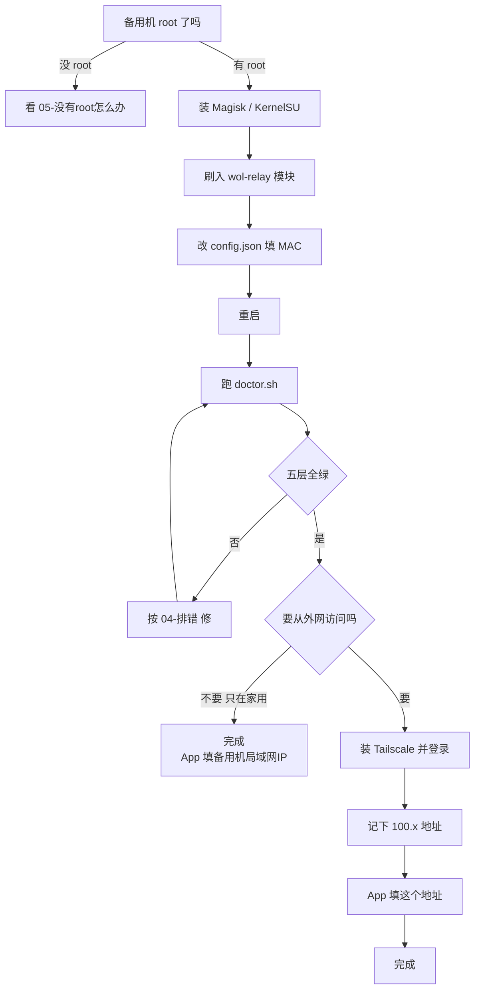
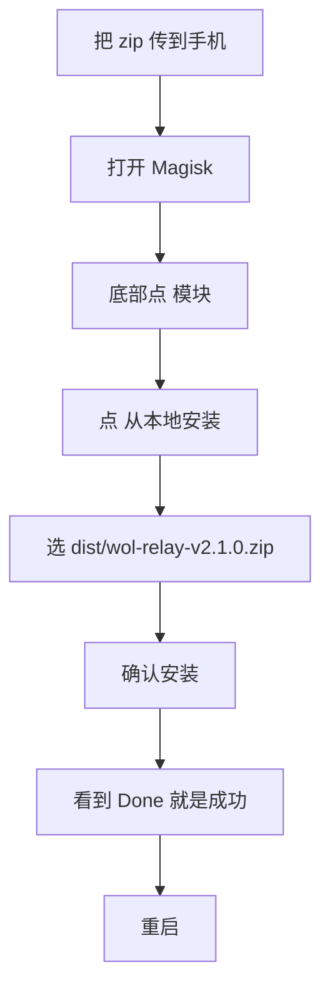
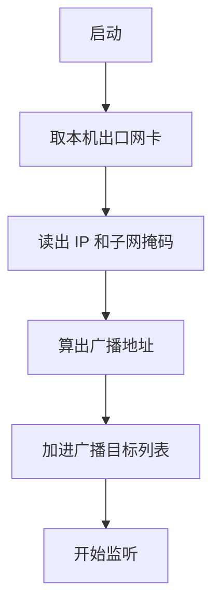
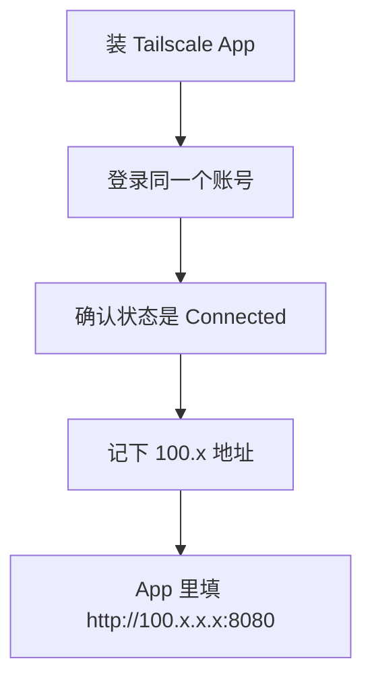
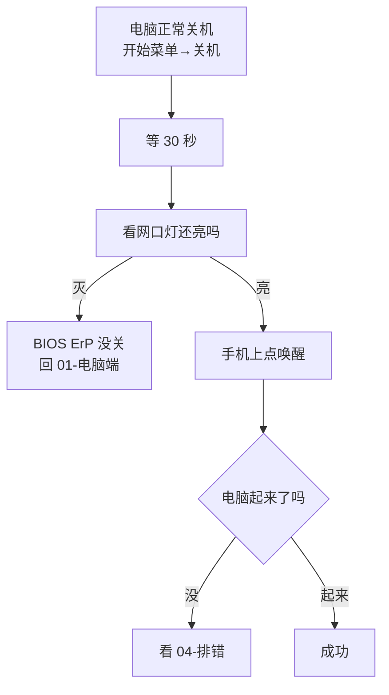

# 三、备用机部署

从刷模块到跑通，大概 10 分钟。

作者：神仙道vq　QQ：1974147300

---

## 全流程



---

## 第一步 · 确认 root

```bash
adb shell su -c id
```

应该输出 `uid=0(root) gid=0(root)` 之类。

没有 `su` 命令、或者提示 `permission denied`，就是没 root 或 root 不完整。看 [05-没有root怎么办](05-没有root怎么办.md)。

### 检查 root 管理器

```bash
adb shell pm list packages | grep -iE "magisk|kernelsu|apatch|topjohnwu|vvb2060"
```

常见包名：

| 包名 | 是什么 |
|---|---|
| `com.topjohnwu.magisk` | Magisk 官方版 |
| `io.github.vvb2060.magisk` | Magisk Alpha（第三方分支） |
| `me.weishu.kernelsu` | KernelSU |
| `me.bmax.apatch` | APatch |

三个都支持，模块格式是通用的。

> **注意 Magisk Alpha**：它的界面和官方版略有区别，底部导航是「主页 / 超级用户 / 模块 / 设置」，找模块页就行。

---

## 第二步 · 刷入模块

### 方式 A：手机上直接刷（推荐）



1. 把 `dist/wol-relay-v2.1.0.zip` 传到手机任意位置
2. 打开 Magisk / KernelSU
3. 底部「模块」→「从本地安装」→ 选 zip
4. 弹出确认框点确定
5. 看到日志里 `- 检查通过：module.prop` / `service.sh` / `wolrelay` 三项和 `Done` 就是成功
6. **重启手机**

### 方式 B：命令行刷（批量或远程）

```bash
adb push dist/wol-relay-v2.1.0.zip /sdcard/Download/
adb shell su -c "magisk --install-module /sdcard/Download/wol-relay-v2.1.0.zip"
adb reboot
```

### 验证刷进去了

```bash
adb shell su -c "ls /data/adb/modules/wol-relay/"
```

应该看到 `module.prop`、`service.sh`、`wolrelay`、`config.json`。

> **如果目录是空的，或者 Magisk 里显示作者为空** —— 说明 `customize.sh` 里写了 `MODPATH=${0%/*}`，把 Magisk 设好的路径覆盖了。这个坑在 `module/customize.sh` 顶部有注释说明，别改回去。

---

## 第三步 · 改配置

刷完后配置在 **`/data/adb/wol-relay/config.json`**，MAC 还是占位值，必须改。

> 为什么不放模块目录里：Magisk 升级模块会把 `/data/adb/modules/wol-relay/` 整个换掉，
> 放里面的 `config.json` 会跟着丢，你填好的 MAC 就白填了。所以配置单独放一个目录，
> 升模块不动它。

```bash
adb shell su -c "cat /data/adb/wol-relay/config.json"
```

内容大概长这样：

```json
{
  "mac": "AA:BB:CC:DD:EE:FF",
  "udp_port": 9,
  "listen": ":8080",
  "targets": ["255.255.255.255"],
  "token": "",
  "repeat": 3,
  "interval_ms": 120,
  "auto_broadcast": true
}
```

### 每个字段什么意思

| 字段 | 说明 | 建议 |
|---|---|---|
| `mac` | **必填**，目标电脑有线网卡的 MAC | 从 `ipconfig /all` 抄，横线冒号都行 |
| `udp_port` | 魔术包端口 | 默认 9，部分主板认 7 |
| `listen` | HTTP 监听地址 | `:8080` 就行，别改 |
| `targets` | 额外广播目标 | 一般留 `255.255.255.255` 够用 |
| `token` | 访问令牌 | 接了公网就填一个随机字符串 |
| `repeat` | 发几轮 | 默认 3，唤不醒可以加到 5 |
| `interval_ms` | 每轮间隔毫秒 | 默认 120 |
| `auto_broadcast` | **自动算本网段广播** | **保持 true**，换了路由器也不用改 |

### 改 MAC

手机上如果有 root 文件管理器（MT 管理器、Solid Explorer），直接编辑 `config.json`。

命令行改：

```bash
adb shell su -c "sed -i 's/AA:BB:CC:DD:EE:FF/你的:MAC:地:址:在:这/g' /data/adb/wol-relay/config.json"
```

改完确认一下：

```bash
adb shell su -c "grep mac /data/adb/wol-relay/config.json"
```

### `auto_broadcast` 为什么重要

打开后，程序每次启动都会：



比如备用机拿到 `192.168.1.50/24`，它就自动算出 `192.168.1.255` 并往那发。

**这样你换路由器、搬家、换网段，都不用改配置。** 这是为了让别人也能直接用，不然每个人都要自己算广播地址。

---

## 第四步 · 重启并自检

```bash
adb reboot
# 等开机完成
adb shell su -c "sh /data/adb/modules/wol-relay/doctor.sh"
```

自检分五层，一层一层看：

| 层 | 检查什么 | 出问题看 |
|---|---|---|
| 1 | root 和模块文件在不在 | 重刷模块 |
| 2 | MAC / token 填了没 | 改 config.json |
| 3 | WiFi 连没连、网关通不通、广播地址算对没 | 查 WiFi 和路由器 |
| 4 | wolrelay 进程在不在 | 看日志 |
| 5 | 8080 端口通不通 | 看日志里的错误 |

全绿就往下走。有 `[X]` 就按提示修，修完再跑一次。

### 自己手动测一下

```bash
# 看状态
adb shell "curl -s http://127.0.0.1:8080/status"

# 真的发一次
adb shell "curl -s -X POST http://127.0.0.1:8080/wake"
```

返回 `{"ok":true,...}` 说明中继本身没问题，问题只可能在"包没到电脑"或"电脑没设好"。

---

## 第五步 · Tailscale（只有需要外网访问才做）

如果备用机只在家里 WiFi 下用，**这步跳过**。



### 装和登录

1. 从应用商店或 [tailscale.com/download](https://tailscale.com/download) 装 App
2. 用你的账号登录（Google / Microsoft / GitHub 都行）
3. 打开开关，等状态变成 `Connected`
4. 在 App 里看到这台设备的 `100.x.x.x` 地址

### 关于 Tailscale 的两个现实问题

**问题一：冷启动慢**


实测从开机到真正能通要 **40 秒到 70 秒**。这意味着：

- 手机刚重启完那一分钟，点唤醒大概率失败
- 模块的 `wait_ts 30` 就是等 90 秒，够用
- 但如果超过 90 秒还没连上，会交给巡护循环继续重试

**问题二：国产 ROM 会杀后台**

OPPO / vivo / 小米 / 荣耀的省电策略会干掉 Tailscale 的后台服务。模块里的巡护循环每 2 分钟检查一次，掉线就重启，能扛住大部分情况。

如果还是经常掉，去系统设置里给 Tailscale 加白名单：

| 品牌 | 位置 |
|---|---|
| OPPO / 一加 | 设置 → 电池 → 应用耗电管理 → Tailscale → 允许后台运行 |
| 小米 / Redmi | 设置 → 应用 → Tailscale → 省电策略 → 无限制 |
| vivo / iQOO | 设置 → 电池 → 后台高耗电 → 允许 |
| 荣耀 | 设置 → 电池 → 更多电池设置 → 休眠时保持网络连接 |

### 更稳的方案：用 magisk-tailscaled

如果备用机有 root，可以不用 Tailscale App，改用 [magisk-tailscaled](https://github.com/anasfanani/magisk-tailscaled)：

- tailscaled 以 root 身份常驻，不受 App 沙箱限制
- 不需要 App 保活，不会被省电策略杀
- 可以用命令行 `tailscale status` 查状态

代价是要在终端里手动 `tailscale login` 走一次授权。

**这个改动我还没做。** 因为它涉及替换你的网络栈，建议先把当前方案跑稳再说。想试的话告诉我，我可以把它做成可选组件。

---

## 第六步 · App 端配置

装 `远程开机.apk`，填三样东西：

| 字段 | 填什么 |
|---|---|
| 网卡 MAC | 和 `config.json` 里的一致 |
| 中继地址 | `100.x.x.x:8080`（外网）或 `192.168.x.x:8080`（只在家里） |
| 访问令牌 | 只有设了 token 才需要填 |

**中继地址可以填多个**，用空格隔开，App 会按顺序试：

```
100.x.x.x:8080 192.168.x.x:8080
```

这样在家里走局域网（快），在外面走 Tailscale（通），不用手动切。

填的时候不用带 `http://`，也不用写 `/wake`，App 会自己补。只写 `host` 的话端口默认按 8080 处理。

---

## 第七步 · 真实测试

**别用重启代替关机测试。**



### 测试步骤

1. 电脑点「开始」→「关机」（**不是重启，不是睡眠**）
2. 等 30 秒，确认真的关了
3. **看网口指示灯**：还亮着说明网卡有电，还有戏；灭了基本没救
4. 手机上点「通过备用机唤醒」
5. 等 20 秒

### 关于测试的一点提醒

如果你人在家里，手机连着家里 WiFi，这时候测的是**局域网路径**，测不出外网能不能通。

要测外网：

- 手机关掉 WiFi，用移动数据
- 或者去公司/朋友家
- **不要**在家里 WiFi 下往自己公网 IP 发包（NAT 回环会骗你）

---

上一步 → [02-路由器设置.md](02-路由器设置.md)　下一步 → [04-排错.md](04-排错.md)
