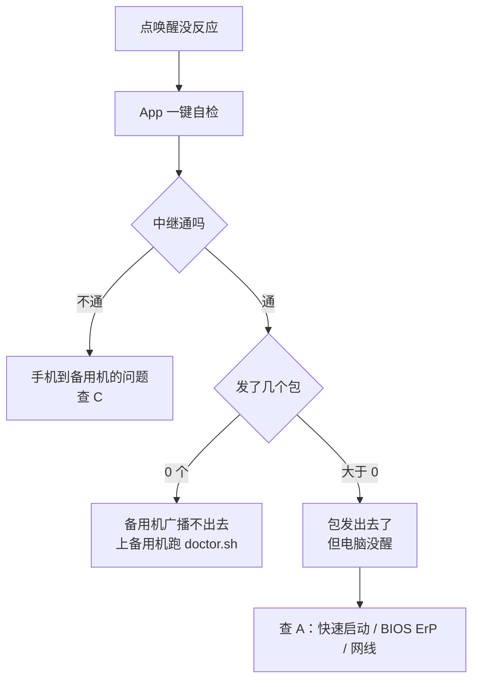
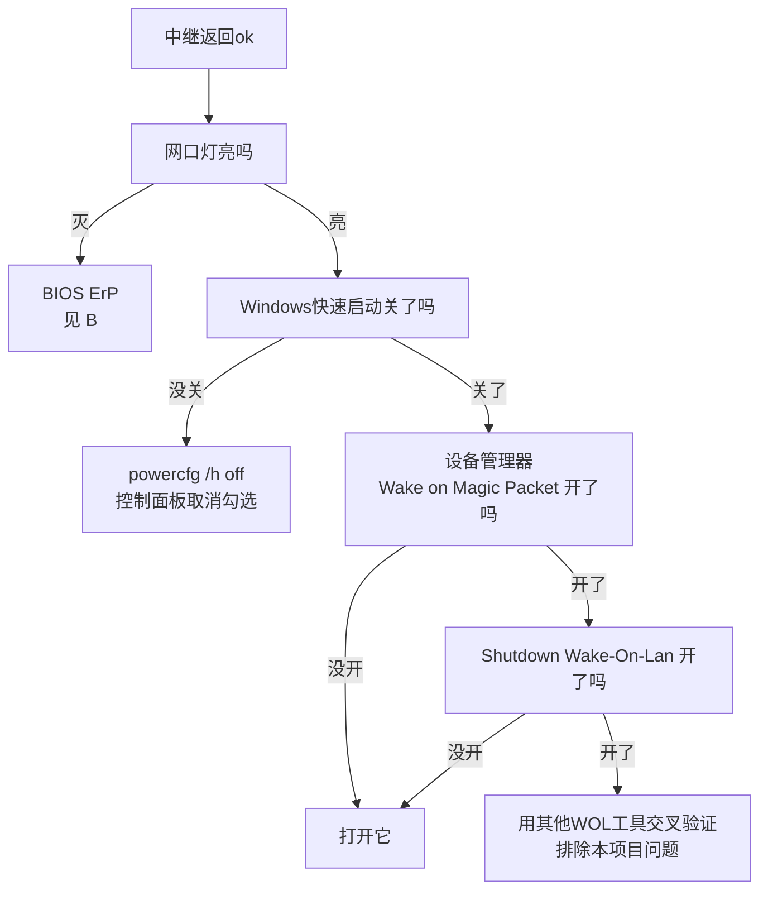
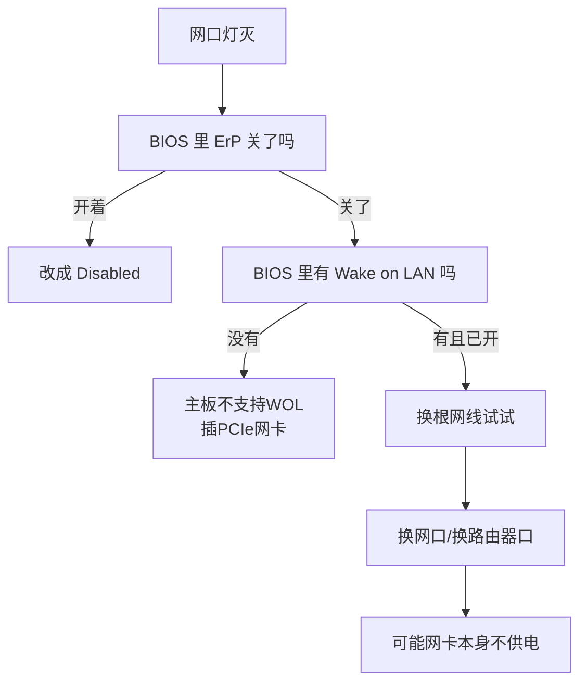
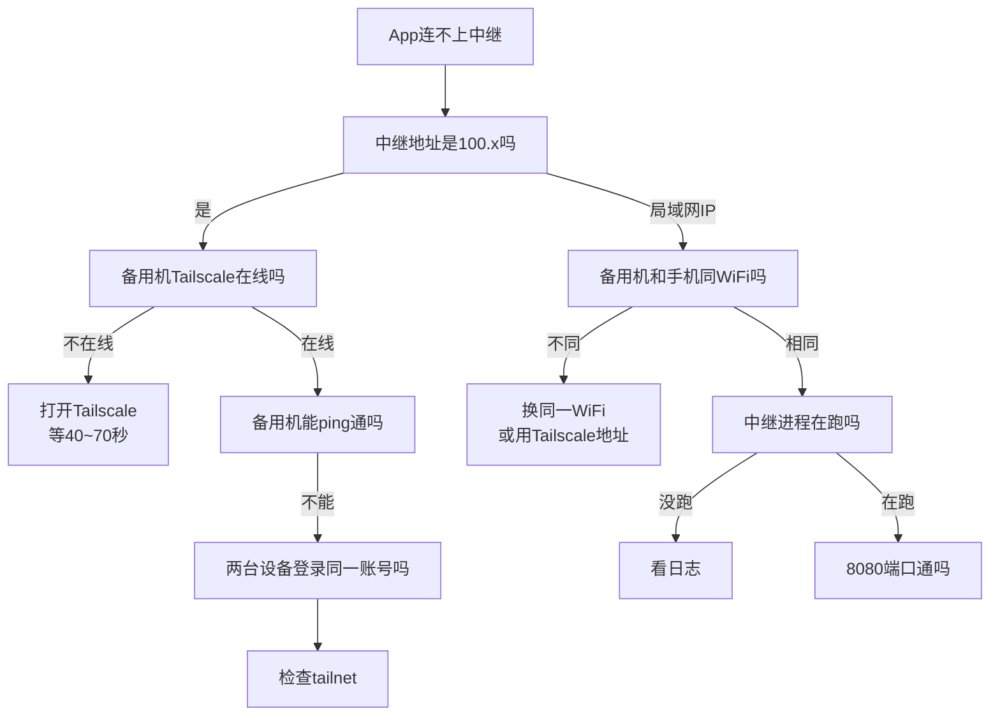
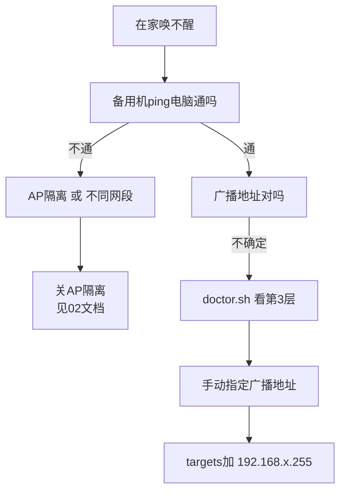
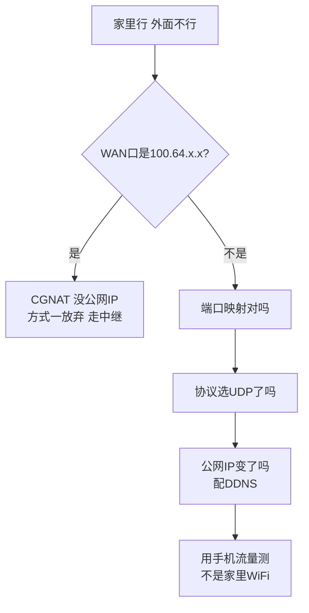
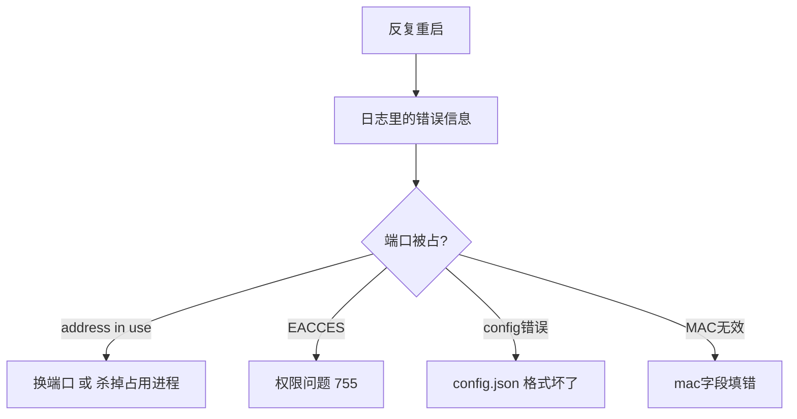
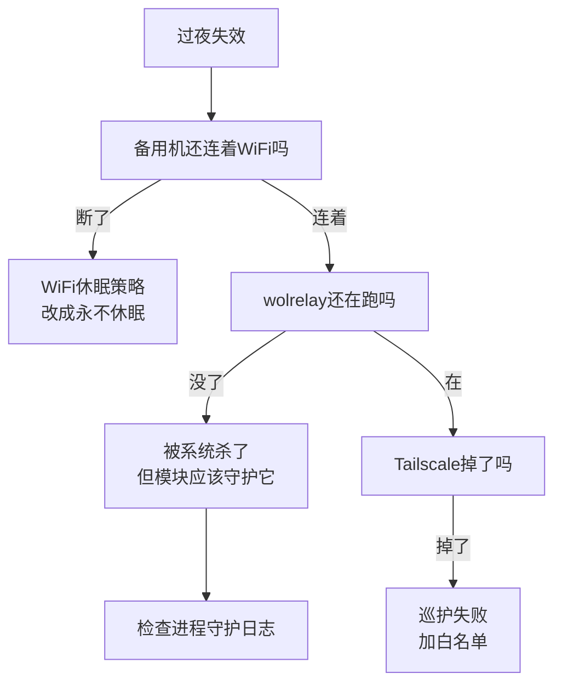
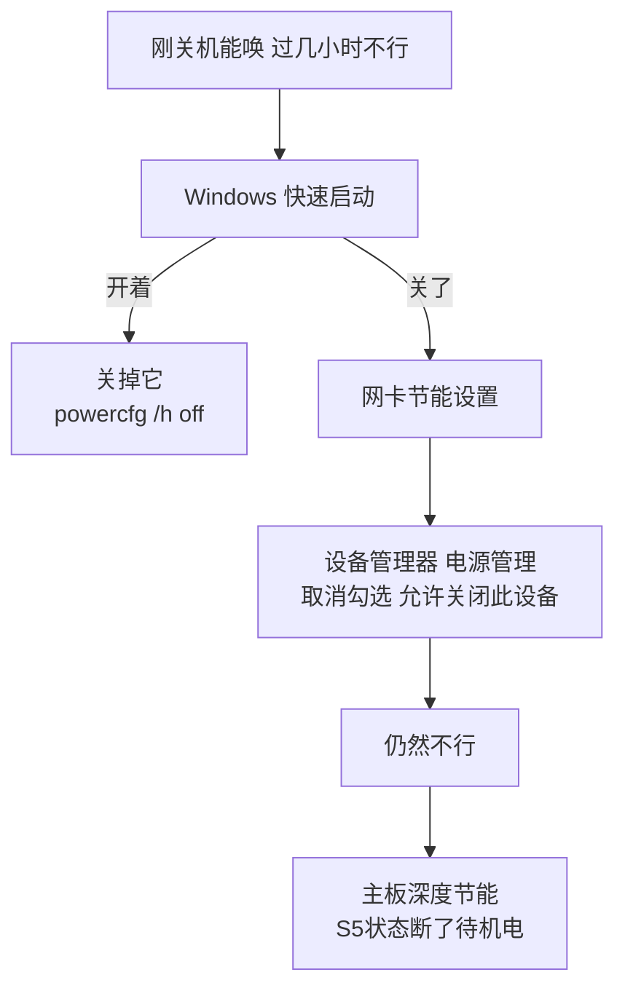

# 四、排错

按症状查，不要按猜测改。每一条都给了验证命令，先确认再动手。

作者：神仙道　QQ：1974147300

---

## 先跑自检

有两个自检，站的位置不一样，别搞混了：

**App 的「一键自检」** —— 在手机上点，管的是「手机到备用机这条路通不通」。
扫本机网段，找到中继，核对 MAC 和鉴权，最后给一句结论。

**备用机上的 doctor.sh** —— 用 adb 或终端跑，管的是「备用机到电脑这条路对不对」。

```bash
adb shell su -c "sh /data/adb/modules/wol-relay/doctor.sh"
```

输出里第一个 `[X]` 就是卡点。下面按症状展开。

### 先判断卡在哪一侧



一句话：**App 的自检只能证明「请求送到了备用机」，
魔术包有没有被电脑收到，App 这边无论如何都看不到 —— 电脑不会回包。**

所以自检说「可以发」，你点完还是没醒，那不是 App 的问题，是电脑那头的事，
直接跳到 [A](#a-中继说成功但电脑不动)。

---

## 症状对照表

| 症状 | 最可能的原因 | 跳到 |
|---|---|---|
| 中继返回 ok，电脑纹丝不动 | Windows 快速启动没关 | [A](#a-中继说成功但电脑不动) |
| 关机后网口灯是灭的 | BIOS 里 ErP 没关 | [B](#b-关机后网口灯不亮) |
| App 显示「备用机连不上」 | Tailscale 掉线 或 中继没起 | [C](#c-备用机连不上) |
| 家里 WiFi 下也唤不醒 | AP 隔离 或 广播地址不对 | [D](#d-在家也唤不醒) |
| 只有外网唤不醒 | 公网 IP / 端口映射问题 | [E](#e-只有外面唤不醒) |
| 模块装了但没反应 | customize.sh 的 MODPATH 坑 | [F](#f-模块装了但完全没反应) |
| 日志里反复重启 wolrelay | 端口被占 或 配置错 | [G](#g-wolrelay-反复重启) |
| 睡一晚上就不行了 | 系统清后台 或 待机断网 | [H](#h-放一晚就失效了) |
| 电脑正常关机，但过一阵唤不醒 | 网卡节能/环保设置 | [I](#i-刚关机能唤醒-过几小时不行) |
| App 自检扫不到备用机 | 不同网段 / AP 隔离 / 端口不是 8080 | [C](#c-备用机连不上) |
| App 说 MAC 不一致 | 备用机 config.json 填错了 | [C](#c-备用机连不上) |

---

## A. 中继说成功但电脑不动

**这是最常见的情况。** 中继返回 `ok: true` 只代表"包发出去了"，不代表"电脑收到了"。



### 一步步排查

**1. 关机后看网口灯**

电脑关机，看机箱后面网口那个小灯：

- **亮（橙色或绿色闪烁）**：网卡有电在听，有戏，往下走
- **灭**：网卡断电了，WOL 物理上不可能工作，跳到 [B](#b-关机后网口灯不亮)

**2. 检查快速启动**

```cmd
powercfg /a
```

如果输出里「休眠」状态是「可用」，说明快速启动可能还开着，执行：

```cmd
powercfg /h off
```

然后去控制面板取消勾选「启用快速启动」，详见 [01-电脑端设置](01-电脑端设置.md)。

**3. 检查网卡唤醒开关**

```cmd
powercfg /devicequery wake_armed
```

如果没列出你的网卡，回设备管理器打开 `Wake on Magic Packet`。

**4. 交叉验证**

装个 [WOL 测试工具](https://www.depicus.com/wake-on-lan/wake-on-lan-cmd)，从**同一局域网的另一台电脑**发一次。如果它也唤不醒，说明问题在电脑不在本项目。

**5. 换端口试试**

有些主板只认 UDP 7 不认 9。改 `config.json`：

```json
"udp_port": 7
```

也可以用 40000 之类的高位端口测试。

---

## B. 关机后网口灯不亮

**这是硬件层面的断电，软件怎么改都没用。**



### 检查 ErP

进 BIOS，找 `ErP`、`ErP Ready`、`EuP`、`Deep Sleep`，**设成 Disabled**。

这是欧盟能效规范要求的选项，打开后关机时主板会切断所有待机电，包括网卡。**很多主板默认是开着的。**

### 可能有单独的电源开关

有些机箱背后的电源开关被按到 `O`（关）了，这样即使插着电也没有待机电。确认开关在 `I`。

### 有些主板只在特定网口支持

少数主板只有第一个网口（LAN1）支持 WOL。换个口试试。

### 插网线时灯亮，关机后灭

如果开机时灯亮、关机后灭了，就是待机电被切断。基本可以确定是 ErP 或者主板不支持。

---

## C. 备用机连不上

App 报「备用机连不上」。



### 先分清是哪一段断了

```bash
# 在备用机上自己测
adb shell "curl -s -m 3 http://127.0.0.1:8080/status"
```

- **有返回**：中继正常，问题在"手机到备用机"这段网络
- **没返回**：中继本身有问题，看 [F](#f-模块装了但完全没反应) 或 [G](#g-wolrelay-反复重启)

### App 自检结果的四种说法，对应四个方向

从 v2.1.0 起，App 会把失败拆成四种，别只看「连不上」三个字：

| App 说 | 意思 | 去查 |
|---|---|---|
| 中继连不上 | TCP 都握不上手 | 备用机没开机 / 不同 WiFi / AP 隔离 / 端口不是 8080 |
| 中继收到了，但一个包都没发出去 | HTTP 通了，广播失败 | 上备用机跑 `doctor.sh`，看第 5 段的广播目标 |
| 中继连上了，但令牌不对 | 返回 403 | 抄 `config.json` 里的 `token` 到 App |
| 中继里的 MAC 跟这台电脑对不上 | `/status` 有返回但 MAC 不同 | 改备用机 `config.json` 的 `mac`，或者改 App 的 |

**自检扫不到备用机**的情况，几乎是这四个原因之一：

1. 手机和备用机不在同一个网段（比如手机连的是访客 WiFi，或者路由器双频分了两个网段）
2. 路由器开了 AP 隔离，设备之间互相看不见
3. 中继监听的不是 8080（改了 `listen` 字段的话，自检扫不到，得手动填地址）
4. 备用机根本没连上 WiFi

第 1、2 条在家用路由器上很常见，尤其是运营商送的光猫自带的 WiFi。

### 如果是 100.x 地址

```bash
# 备用机上确认 Tailscale 状态
adb shell "ip route show table all | grep 100."
```

有输出说明隧道通。没输出说明 Tailscale 掉线了。

```bash
# 手机 ping 备用机
adb shell "ping -c 3 100.x.x.x"
```

ping 不通就检查：

1. 两台设备登录的是**同一个 Tailscale 账号**吗
2. 备用机的 Tailscale 开关是打开的吗
3. Tailscale 后台（admin console）里两台设备是不是都在线
4. 有没有开了 ACL 限制

### 如果是局域网 IP

先确认两台设备在同一网段：

```bash
# 备用机
adb shell "ip -4 addr show wlan0 | grep inet"
# 手机
adb shell "ip -4 addr show wlan0 | grep inet"
```

前三位一样（比如都是 `192.168.1.x`）才是同一网段。

**不在同一网段**：可能是连了不同的 WiFi（2.4G / 5G 有时是不同网段），或者有双重 NAT。

**在同一网段还连不上**：检查路由器有没有开 AP 隔离，见 [D](#d-在家也唤不醒)。

---

## D. 在家也唤不醒

备用机和电脑都在家里，还是唤不醒。



### 关键验证：备用机能不能 ping 通电脑

```bash
# 电脑开机状态下，从备用机 ping
adb shell "ping -c 3 192.168.1.23"
```

**这一步很重要**，因为它验证了二层/三层连通性。ping 不通的话，广播包也到不了。

### 广播地址算错了吗

`doctor.sh` 的第 3 层会打印算出来的广播地址。它应该是你网段的 `.255`（/24 的情况）。

如果不对，可以在 `config.json` 里手动指定：

```json
"targets": ["255.255.255.255", "192.168.1.255"]
```

`targets` 和 `auto_broadcast` 是叠加的，不会冲突。多填一个手动地址当保险。

### 掩码不是 /24 的情况

少见但存在，比如 `/16` 或者 `/23`。这时候广播地址不是 `.255`。

比如 `192.168.0.50/23`，广播地址是 `192.168.1.255`。

`auto_broadcast` 会正确计算，但手动填的话要算对。

---

## E. 只有外面唤不醒

在家的 WiFi 下能唤醒，出了门就不行。



### 先确认是不是 CGNAT

登录路由器后台，看 WAN 口 IP。

如果在 `100.64.0.0` ~ `100.127.255.255` 之间 —— **没有公网 IP**，方式一不可能成功。走中继。

### 端口映射的三个常见错误

1. **协议选成 TCP** —— 必须是 UDP
2. **内部 IP 填错** —— 要填电脑的实际 IP
3. **双重 NAT 只映射了一层** —— 光猫和路由器都要配

### 不要在家里的 WiFi 下测公网

这是最容易骗人的地方。


在家测公网 IP，包根本没出门，路由器自己转回来了。**必须用移动数据测。**

---

## F. 模块装了但完全没反应

```mermaid
flowchart TD
    A[模块没反应] --> B[Magisk里有这个模块吗]
    B -->|没有| C[根本没装上<br/>重刷]
    B -->|有但显示空白| D[MODPATH坑<br/>customize.sh写错了]
    D --> E[去掉 MODPATH=${0%/*}<br/>重刷]
    B -->|有且正常| F[日志文件存在吗]
    F -->|不存在| G[service.sh没执行<br/>检查权限755]
    F -->|存在| H[看日志内容]
```

### 检查模块目录

```bash
adb shell su -c "ls -la /data/adb/modules/wol-relay/"
```

**应该有**：`module.prop`、`service.sh`、`wolrelay`、`config.json`

**如果目录是空的**，或者只有 `META-INF`：

这就是 `customize.sh` 里写了 `MODPATH=${0%/*}` 导致的。Magisk 是 `. source` 执行 customize.sh 的，此时 `$0` 指向 `update-binary`，把正确路径覆盖了，文件解压到了别的地方。

**修法**：删掉那行，重新打包刷入。本项目的 `customize.sh` 已经改好了，顶部有注释。

**如果 Magisk 里模块名显示成「wolrelay ，作者 」**，也是同一个原因 —— 读不到 module.prop。

### 检查日志

```bash
adb shell "cat /data/local/tmp/wolrelay.log"
```

**文件不存在**：`service.sh` 根本没执行。

- 检查 `service.sh` 权限是不是 755
- 用 `su -c "sh /data/adb/modules/wol-relay/service.sh"` 手动跑一次，看有没有报错

---

## G. wolrelay 反复重启

日志里不断出现「启动 wolrelay」和「wolrelay 退出了」。



### 看具体报错

```bash
adb shell "tail -30 /data/local/tmp/wolrelay.log"
```

**`bind: address already in use`** —— 8080 被别的程序占了。

```bash
# 查谁占了
adb shell su -c "netstat -tlnp | grep 8080"
```

改 `config.json` 的 `listen` 到别的端口，比如 `:8090`。

**`config.json 格式错误`** —— JSON 语法坏了。常见是多了逗号、少了引号。

```bash
# 验证 JSON
adb shell su -c "cat /data/adb/wol-relay/config.json" | python -m json.tool
```

**`MAC 必须是 12 位十六进制`** —— mac 字段填错了。可能填成了 IP，或者少了几位。

**`还没设置 MAC`** —— mac 字段是空的。

---

## H. 放一晚就失效了

白天好好的，第二天早上发现唤不醒。



### 三个常见原因

**1. WiFi 休眠**

安卓默认在息屏一段时间后断开 WiFi 省电。

开发者选项里有个「保持唤醒状态（充电时）」，或者：

```bash
adb shell su -c "settings put global wifi_sleep_policy 2"
```

`2` 表示永不休眠。有些 ROM 不认这个设置，要去系统设置里找「WiFi 高级设置 → 保持 WiFi 开启」。

**2. 系统清后台**

国产 ROM 会定时清理。把中继相关的加白名单：

- 给 Magisk 加白名单（一般不必要，root 进程不受限）
- 给 Tailscale 加白名单（**这个必要**）

**3. 路由器定时重启 / IP 变了**

有些路由器设了定时重启，重启后备用机的 IP 可能变了。

`auto_broadcast` 能扛住广播地址变化，但如果 App 里填的是局域网 IP，IP 变了就连不上。

**解决**：在路由器里给备用机做 DHCP 静态绑定，或者 App 里用 Tailscale 地址而不是局域网 IP。

---

## I. 刚关机能唤醒，过几小时不行



这个症状的典型特征是"**有延迟的失败**"。

刚关机时系统还在做关机流程，网卡可能暂时还通；等真进入 S5（深度关机），待机电被切断或网卡进入低功耗模式，就不听了。

依次检查：

1. 快速启动（最常见）
2. 网卡「允许计算机关闭此设备以节约电源」—— 有些情况**取消勾选**反而能保持唤醒能力
3. BIOS 里的 `Deep Sleep` / `Deep S5` 关掉

---

## 通用排错手段

### 在电脑上抓包确认

如果怀疑包根本没到，可以在电脑上抓：

```bash
# 电脑开机状态下，装 Wireshark，过滤
udp.port == 9
```

注意：**电脑关机时抓不到包**，这个方法只能验证「包有没有到网卡」。想看关机状态，只能靠网口灯。

### 在备用机上抓广播

```bash
# 看有没有真的往广播地址发
adb shell su -c "tcpdump -i wlan0 -n udp port 9" 
```

如果备用机没有 tcpdump，可以把它当路由器的"眼睛"——路由器后台一般有流量统计。

### 收集日志贴 issue

```bash
adb shell su -c "sh /data/adb/modules/wol-relay/doctor.sh" > report.txt
adb shell "cat /data/local/tmp/wolrelay.log" >> report.txt
```

`doctor.sh` 里的 MAC 和 IP 会自动打码，可以直接贴。

---

上一步 → [03-备用机部署.md](03-备用机部署.md)　下一步 → [05-没有root怎么办.md](05-没有root怎么办.md)
