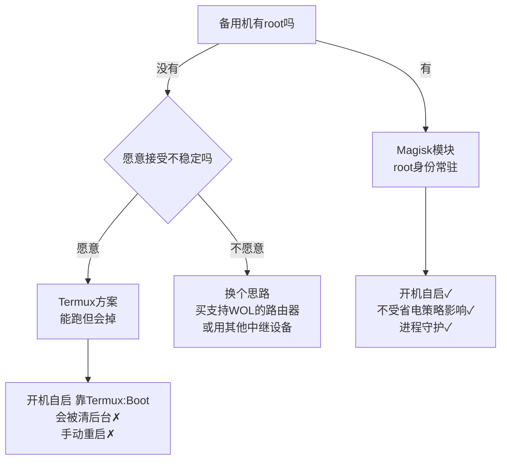
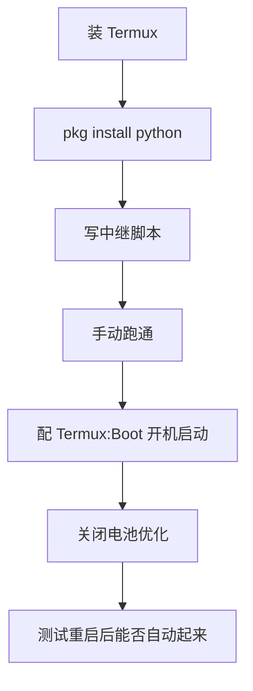
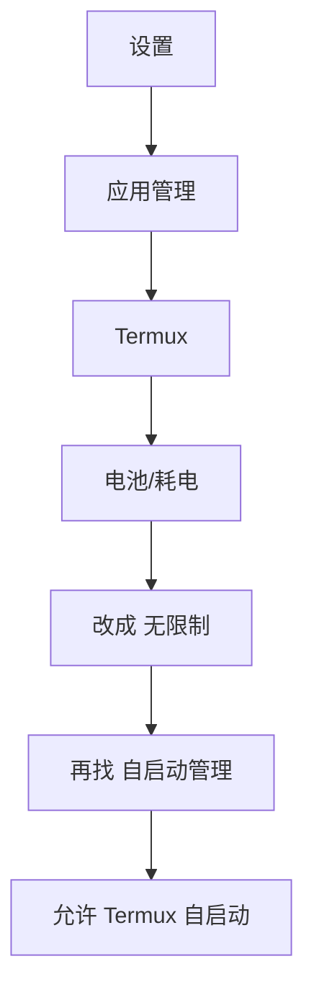
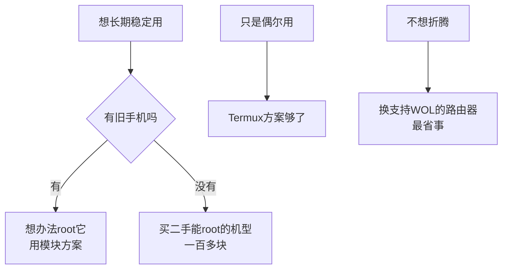

# 五、没有 root 怎么办

这个项目最硬的限制是 root。但没 root 也不是完全没路走，只是要接受它不如模块稳。

作者：神仙道vq　QQ：1974147300

---

## 先说清楚差别



| | Magisk 模块 | Termux 方案 |
|---|---|---|
| 运行身份 | root | 普通用户 |
| 开机自启 | 模块脚本，可靠 | Termux:Boot，经常失效 |
| 被系统清后台 | 不会 | 会，尤其国产 ROM |
| 进程守护 | 有 | 要自己写 |
| 需要 root | 是 | 否 |
| 折腾程度 | 刷一次就行 | 要调不少 |

**说实话**：Termux 方案能用，但别指望它连续跑几个月不出事。如果你是"偶尔用一次"的场景，够用；如果希望"随时都能开"，还是建议找台能 root 的旧手机。

---

## Termux 方案

### 需要什么

- 备用机上装 [Termux](https://f-droid.org/packages/com.termux/)（**从 F-Droid 装，不要从 Play 商店**，商店版本早停更了）
- 装 [Termux:Boot](https://f-droid.org/packages/com.termux.boot/)（开机自启）
- 装 [Termux:API](https://f-droid.org/packages/com.termux.api/)（可选，用来保持唤醒）

### 步骤



### 1. 装依赖

```bash
pkg update && pkg upgrade -y
pkg install python -y
termux-wake-lock    # 防止被系统休眠
```

`termux-wake-lock` 会在通知栏挂一个常驻通知，这是它保活的唯一手段。

### 2. 中继脚本

保存为 `~/wol.py`：

```python
#!/usr/bin/env python3
# WOL 中继（Termux 版）
# 作者：神仙道vq  QQ 1974147300
import json
import socket
import subprocess
import sys
from http.server import BaseHTTPRequestHandler, HTTPServer

# ===== 改成你自己的 =====
MAC = "AA:BB:CC:DD:EE:FF"
PORT = 8080
UDP_PORT = 9
TOKEN = ""          # 留空表示不校验
# =======================

def magic(mac: str) -> bytes:
    hw = bytes.fromhex(mac.replace(":", "").replace("-", ""))
    if len(hw) != 6:
        raise ValueError("MAC 格式不对")
    return b"\xff" * 6 + hw * 16

def broadcast_addr() -> str:
    """从默认路由自动推算本网段广播地址"""
    try:
        out = subprocess.check_output(
            ["ip", "-4", "addr", "show"], text=True, timeout=3)
    except Exception:
        return "255.255.255.255"
    import re
    for m in re.finditer(r"inet (\d+\.\d+\.\d+\.\d+)/(\d+)", out):
        ip, cidr = m.group(1), int(m.group(2))
        if ip.startswith("127.") or ip.startswith("100."):
            continue
        parts = [int(x) for x in ip.split(".")]
        mask = (0xFFFFFFFF << (32 - cidr)) & 0xFFFFFFFF
        ipn = (parts[0] << 24) | (parts[1] << 16) | (parts[2] << 8) | parts[3]
        b = ipn | (~mask & 0xFFFFFFFF)
        return ".".join(str((b >> s) & 0xFF) for s in (24, 16, 8, 0))
    return "255.255.255.255"

class H(BaseHTTPRequestHandler):
    def log_message(self, fmt, *args):
        print("%s %s" % (self.address_string(), fmt % args), flush=True)

    def _json(self, code, obj):
        body = json.dumps(obj).encode()
        self.send_response(code)
        self.send_header("Content-Type", "application/json")
        self.send_header("Content-Length", str(len(body)))
        self.end_headers()
        self.wfile.write(body)

    def do_GET(self):
        if self.path.startswith("/status"):
            self._json(200, {"ok": True, "mac": MAC, "targets": [broadcast_addr()]})
        else:
            self._json(404, {"ok": False, "error": "not found"})

    def do_POST(self):
        if TOKEN and f"token={TOKEN}" not in self.path and \
                self.headers.get("X-Wol-Token") != TOKEN:
            self._json(403, {"ok": False, "error": "token 不对"})
            return
        try:
            pkt = magic(MAC)
            bc = broadcast_addr()
            s = socket.socket(socket.AF_INET, socket.SOCK_DGRAM)
            s.setsockopt(socket.SOL_SOCKET, socket.SO_BROADCAST, 1)
            ok = 0
            for t in {bc, "255.255.255.255"}:
                try:
                    s.sendto(pkt, (t, UDP_PORT))
                    ok += 1
                except Exception as e:
                    print("发往 %s 失败: %s" % (t, e), flush=True)
            s.close()
            self._json(200, {"ok": ok > 0, "sent": ok, "target": bc})
        except Exception as e:
            self._json(500, {"ok": False, "error": str(e)})

if __name__ == "__main__":
    print("WOL 中继启动 :%d  MAC=%s" % (PORT, MAC), flush=True)
    HTTPServer(("0.0.0.0", PORT), H).serve_forever()
```

改开头的 `MAC`，然后：

```bash
python ~/wol.py
```

浏览器打开 `http://127.0.0.1:8080/status` 看有没有返回。

### 3. 开机自启

Termux:Boot 会执行 `~/.termux/boot/` 目录下的脚本。

```bash
mkdir -p ~/.termux/boot
cat > ~/.termux/boot/wol.sh <<'EOF'
#!/data/data/com.termux/files/usr/bin/sh
termux-wake-lock
sleep 20
python ~/wol.py >> ~/wol.log 2>&1
EOF
chmod +x ~/.termux/boot/wol.sh
```

`sleep 20` 是等 WiFi 连上，太早启动会拿不到 IP。

### 4. 关掉电池优化

**这一步不做，Termux 撑不过一天。**



各品牌位置：

| 品牌 | 路径 |
|---|---|
| 小米 / Redmi | 设置 → 应用设置 → 应用管理 → Termux → 省电策略 → 无限制；再开自启动 |
| OPPO / 一加 | 设置 → 电池 → 应用耗电管理 → Termux → 允许后台运行 + 允许自启动 |
| vivo / iQOO | 设置 → 电池 → 后台高耗电 → 允许 Termux |
| 华为 / 荣耀 | 设置 → 电池 → 启动管理 → Termux → 手动管理，三个全开 |
| 三星 | 设置 → 电池 → 后台使用限制 → 从「休眠应用」里移除 |

### 5. 保持屏幕唤醒的替代方案

如果系统太顽固，可以考虑：

- **开发者选项 → 充电时不锁屏**（牺牲屏幕寿命）
- **Tasker + AutoInput** 定时点一下（麻烦但有效）

---

## Termux 方案的已知问题

### 问题一：没有 root，看不到系统网卡状态

`ip addr` 在 Termux 里能跑，但看不到 Tailscale 的网卡。判断隧道状态要靠 ping。

### 问题二：发广播需要 WiFi 保持活跃

安卓在息屏后会降低 WiFi 活跃度。`termux-wake-lock` 能缓解，但不彻底。

如果发现经常失效，试试在路由器里把备用机的 WiFi 频段固定到 2.4G（穿透好，功耗低，连接更稳）。

### 问题三：Termux:Boot 在部分 ROM 上不生效

这是最麻烦的。某些 ROM 会拦截 `BOOT_COMPLETED` 广播。

**变通办法**：用 Tasker 或 MacroDroid 监听开机事件，然后 `am start` 拉起 Termux 执行脚本。

---

## 完全不用 root 的第三条路

如果你实在不想折腾，还有这些选择：

### 方案一：换支持 WOL 的路由器

很多路由器自带网络唤醒功能（华硕、OpenWrt、爱快都有）。在路由器后台点一下就能唤醒，不需要备用机。

**优点**：最稳，路由器本来就是 7×24 开着的
**缺点**：得换路由器，或者你的路由器得能刷固件

### 方案二：用树莓派 / 旧电脑当跳板

比手机稳得多，但功耗高（5~15W，一年电费几十块）。

### 方案三：智能插座 + 主板「来电自启」

开机箱 BIOS 里打开 `Restore on AC Power Loss` / `AC Back`，然后用智能插座断电再通电，电脑就开了。

**优点**：完全不用网络配置
**缺点**：**硬断电对硬盘不友好**，长期这么搞容易坏盘。而且没法正常关机，只能强断。

**这个方案我不推荐用于有重要数据的机器。** 但如果是台老机器只用来挂机，可以考虑。

### 方案四：Wake-on-LAN over Internet 服务

有些第三方服务（比如 Depicus 的在线 WOL）可以代为发广播，但需要你的电脑暴露在公网，安全性差，不推荐。

---

## 我的建议



二手的 Redmi Note 系列、红米老机型、一加 6/7 之类，一百多块钱，刷个 Magisk 很简单。比折腾 Termux 保活省心得多。

---

上一步 → [04-排错.md](04-排错.md)　下一步 → [06-适合哪些设备.md](06-适合哪些设备.md)
