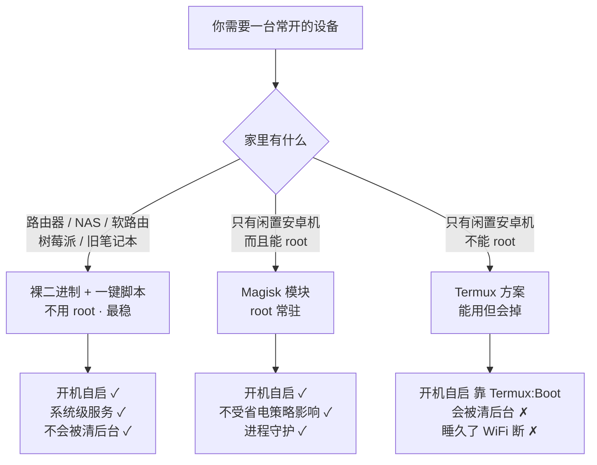
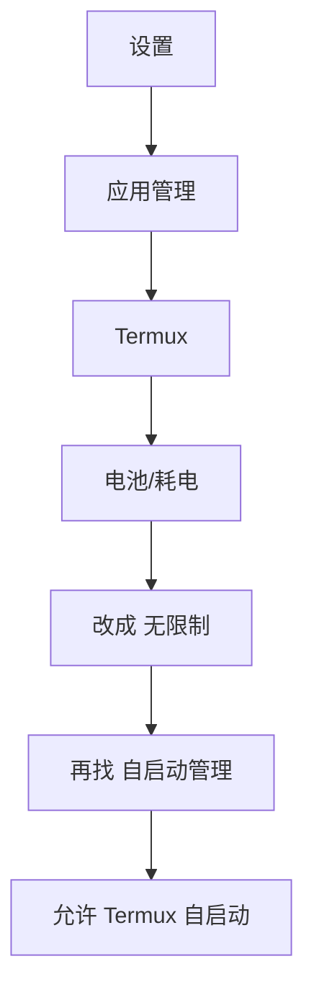
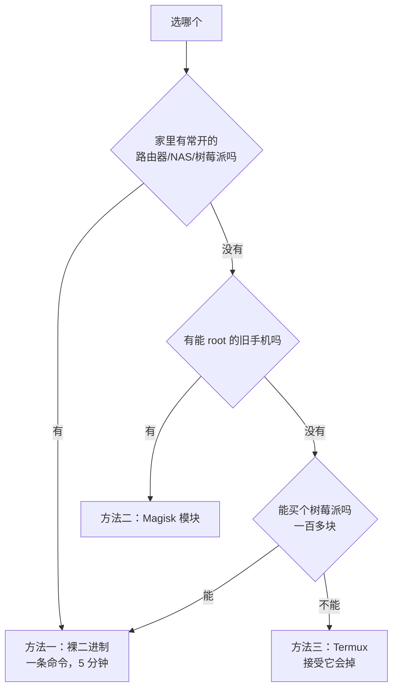

# 五、没有 root 怎么办

**结论先放这**：从 v2.2.0 起，root 不再是这个项目的要求。

中继是一个 30KB 的纯静态 Go 程序，除了「常开」之外没有硬要求。
Magisk 模块只是把它装到安卓机上的一种方式 —— 而安卓机恰恰是这几类设备里
最不稳的一种（厂商省电策略、系统清后台、ROM 拦截开机广播）。

**如果你家里有路由器、NAS、树莓派、软路由、群晖、或者一台常年开着的旧笔记本，
用它们比用手机稳，而且不用 root。**

作者：神仙道　QQ：1974147300

---

## 三条路，按稳定性排



| | 裸二进制（路由器/NAS/树莓派） | Magisk 模块 | Termux |
|---|---|---|---|
| 需要 root | **不需要** | 是 | 否 |
| 开机自启 | 系统服务，最可靠 | 模块脚本，可靠 | Termux:Boot，经常失效 |
| 被系统清后台 | 不会 | 不会 | **会**，尤其国产 ROM |
| 进程守护 | systemd / procd 自带 | 有 | 要自己写 |
| 功耗 | 3~15W（路由器 3W） | 手机待机 1~2W | 同手机 |
| 折腾程度 | **一条命令** | 刷一次 | 要调不少 |

---

## 方法一：裸二进制 + 一键脚本（推荐）

### 适用设备

只要满足两条：**能跑 Linux**、**常年开着**。

| 设备 | 架构 | 备注 |
|---|---|---|
| OpenWrt / 爱快 / 大部分家用路由器 | mipsle / arm / arm64 | 用 `uname -m` 看 |
| 群晖 / 威联通 NAS | amd64 / arm64 | 本身就 7×24 |
| 树莓派 1/2/3/4/5 | armv6 / armv7 / arm64 | 3W 功耗，最合适 |
| 软路由（x86） | amd64 | 跑着 OpenWrt 或 Debian |
| 旧笔记本 / 旧 NUC | amd64 | 关了屏幕盖上盖子就行 |
| Docker 宿主机 | amd64 | 见下面「容器」一节 |

### 一条命令

```bash
curl -fsSL https://raw.githubusercontent.com/huangJUN6666/wol-relay-android/main/scripts/install.sh | sudo sh
```

脚本会自己做完这些：

1. 认出架构（`x86_64→amd64`、`aarch64→arm64`、`armv7l→armv7` ...）
2. 认出启动方式（systemd / OpenWrt procd / 群晖 / SysV / BusyBox init.d）
3. 下载对应架构的二进制，**先跑一次 `-version` 确认它真能在这台机器上执行**
4. 生成配置到 `/etc/wolrelay/config.json`（已存在则不动，升级不丢 MAC）
5. 装开机自启、起服务、打印自检结果

**想先看看它会做什么**，加 `--dry-run`，它只打印不落盘：

```bash
curl -fsSL https://raw.githubusercontent.com/huangJUN6666/wol-relay-android/main/scripts/install.sh | sudo sh -s -- --dry-run
```

**卸载**：

```bash
curl -fsSL https://raw.githubusercontent.com/huangJUN6666/wol-relay-android/main/scripts/install.sh | sudo sh -s -- --uninstall
```

### 装完必须做的事

脚本不会替你填 MAC —— 这是故意的。写个 `AA:BB:CC:DD:EE:FF` 进去，
你会看到「启动成功、端口在听、日志一切正常」，但电脑永远不醒。
**假成功比报错难查十倍**，所以宁可留空让自检直接告诉你「MAC 还没填」。

```bash
sudo vi /etc/wolrelay/config.json
```

```json
{
  "devices": [
    {"name": "pc", "mac": "1A:2B:3C:4D:5E:6F"}
  ]
}
```

`mac` 填**电脑有线网卡**的物理地址（WiFi 网卡关机后断电，唤不醒）。
Windows 上查：`ipconfig /all`，看「物理地址」。Linux 上：`ip link`。

改完重启并自检：

```bash
sudo systemctl restart wolrelay        # OpenWrt 用 /etc/init.d/wolrelay restart
sudo /opt/wolrelay/wolrelay -config /etc/wolrelay/config.json -doctor
```

自检输出里**第一个 `[X]` 就是卡住的地方**。

### 手动装（不想跑脚本）

```bash
# 1. 下对应架构的二进制（去 Releases 页面看文件名）
wget https://github.com/huangJUN6666/wol-relay-android/releases/latest/download/wolrelay-linux-arm64
chmod +x wolrelay-linux-arm64
sudo mv wolrelay-linux-arm64 /usr/local/bin/wolrelay

# 2. 配置
sudo mkdir -p /etc/wolrelay
sudo cp config.example.json /etc/wolrelay/config.json   # 从仓库里拿
sudo vi /etc/wolrelay/config.json

# 3. 先手动跑通，再装服务
wolrelay -config /etc/wolrelay/config.json -doctor
```

手动跑通了再装自启 —— 顺序反了的话，服务起不来看日志也看不出所以然。

### 容器

容器里没有 init，装不了自启服务。用 `--restart=always` 代替：

```bash
docker run -d --name wolrelay --restart=always \
  --network host \
  -v /etc/wolrelay:/etc/wolrelay \
  alpine /opt/wolrelay/wolrelay -config /etc/wolrelay/config.json
```

**`--network host` 是必须的**。桥接网络下容器看不到宿主机的物理网卡，
算不出正确的广播地址，包会发到一个容器自己的虚拟网段里去，
而且日志照样写「发送成功」。

---

## 方法二：Magisk 模块（root）

如果你手上正好有能 root 的安卓机，这条路依然可用，而且比 Termux 稳得多。

下载 Release 里的 `wol-relay-v2.2.0.zip`，在 Magisk / KernelSU / APatch 里刷入。

配置在 `/data/adb/wol-relay/config.json`（不是模块目录里 —— 升级模块会把模块目录整个换掉）：

```bash
su -c 'vi /data/adb/wol-relay/config.json'
su -c 'sh /data/adb/modules/wol-relay/doctor.sh'
```

---

## 方法三：Termux（安卓机不能 root 时）

**先说清楚**：这条路能用，但别指望连续跑几个月不出事。
如果只是「偶尔用一次」，够用；如果希望「随时都能开」，
**建议改用方法一** —— 一台 3W 的树莓派比这省心一百倍。

### 为什么现在不推荐 Termux

v2.2.0 之前 Termux 是「没 root」的唯一出路，所以文档里给了个 Python 版中继。
现在有更好的选择了，而且那个 Python 版**没有唤醒确认功能**
（它只会告诉你「包发出去了」，不会告诉你「电脑醒了」）。

如果你还是要用 Termux，直接跑官方二进制就行 —— Termux 就是个 Linux：

```bash
pkg update && pkg install curl -y
termux-wake-lock                       # 防止被系统休眠

# Termux 在 arm64 安卓上是 linux/arm64，直接下官方产物
curl -fL -o wolrelay \
  https://github.com/huangJUN6666/wol-relay-android/releases/latest/download/wolrelay-linux-arm64
chmod +x wolrelay
./wolrelay -config ./config.json
```

比 Python 版多出来的东西：唤醒确认、多设备、自检、ARP 反查。

### 开机自启

```bash
mkdir -p ~/.termux/boot
cat > ~/.termux/boot/wol.sh <<'EOF'
#!/data/data/com.termux/files/usr/bin/sh
termux-wake-lock
sleep 20          # 等 WiFi 连上，太早启动拿不到 IP
cd ~ && ./wolrelay -config ./config.json >> ~/wol.log 2>&1
EOF
chmod +x ~/.termux/boot/wol.sh
```

### 关掉电池优化（不做出撑不过一天）



| 品牌 | 路径 |
|---|---|
| 小米 / Redmi | 设置 → 应用设置 → 应用管理 → Termux → 省电策略 → 无限制；再开自启动 |
| OPPO / 一加 | 设置 → 电池 → 应用耗电管理 → Termux → 允许后台运行 + 允许自启动 |
| vivo / iQOO | 设置 → 电池 → 后台高耗电 → 允许 Termux |
| 华为 / 荣耀 | 设置 → 电池 → 启动管理 → Termux → 手动管理，三个全开 |
| 三星 | 设置 → 电池 → 后台使用限制 → 从「休眠应用」里移除 |

### Termux 已知的三个坑

**坑一：Termux:Boot 在部分 ROM 上不生效。**
某些 ROM 会拦截 `BOOT_COMPLETED` 广播。变通办法：用 Tasker / MacroDroid
监听开机事件，然后 `am start` 拉起 Termux 执行脚本。

**坑二：息屏后 WiFi 降频。**
安卓息屏会降低 WiFi 活跃度，`termux-wake-lock` 只能缓解。
可以试试在路由器里把备用机的 WiFi 固定到 2.4G（穿透好、功耗低、连接稳）。

**坑三：System WebView 更新后 Termux 可能崩。**
遇到过就重装 Termux，配置在 `~` 下，重新 `chmod +x` 就行。

---

## 一条都不满足的话

### 智能插座 + 主板「来电自启」

BIOS 里打开 `Restore on AC Power Loss` / `AC Back`，用智能插座断电再通电。

- 优点：完全不用网络配置，几十块钱
- 缺点：**硬断电对硬盘不友好**，长期这么搞容易坏盘；没法正常关机

**有重要数据的机器别用这个。** 老机器只用来挂机可以考虑。

### 换支持 WOL 的路由器

很多路由器自带网络唤醒（华硕、OpenWrt、爱快都有）。
但注意：**路由器自带的 WOL 通常也只告诉你「已发送」**，
不会确认到底醒没醒 —— 这正是本项目想解决的那件事。

### 直接用公网

不用中继，App 里走「方式三：直连公网」，需要路由器做端口映射。
缺点是没法确认到底醒没醒，而且要把 UDP 9 暴露出去。

---

## 我的建议



**一句话**：一台树莓派（3W，一年电费不到 10 块）比折腾手机保活省心得多，
而且现在装它只需要一条命令。

---

上一步 → [04-排错.md](04-排错.md)　下一步 → [06-适合哪些设备.md](06-适合哪些设备.md)
