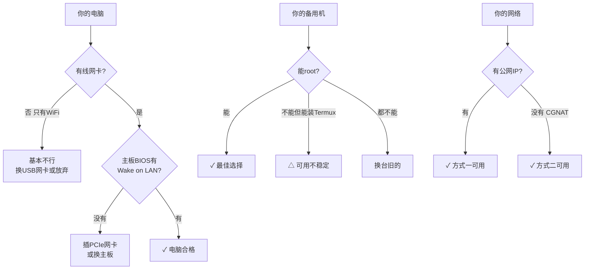
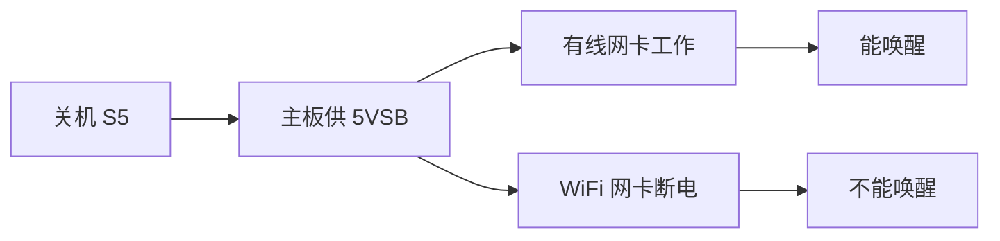
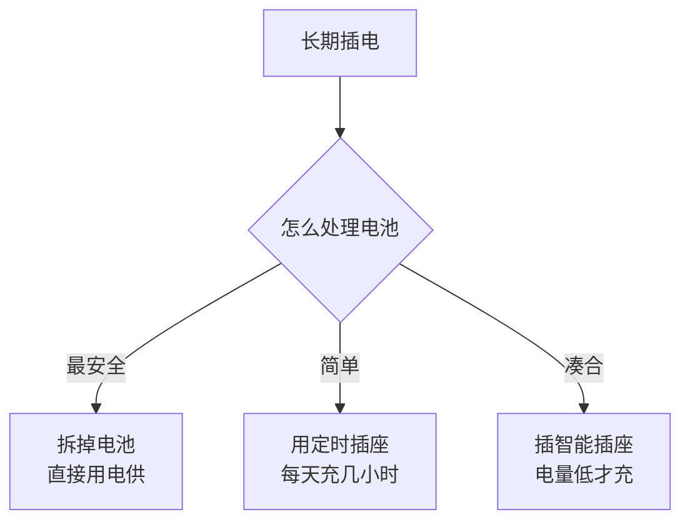
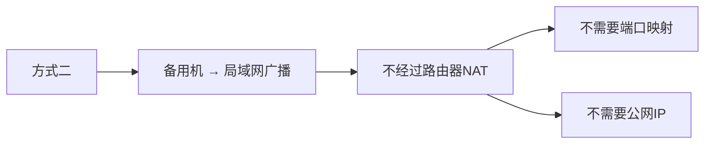

# 六、适合哪些设备

每个环节都有硬性要求，不符合就会卡住。这部分帮你**在动手之前就判断出来能不能成**，别白折腾两小时。

作者：神仙道vq　QQ：1974147300

---

## 一页判断

---

## 一、电脑（目标机）

### 硬性要求

| 项目 | 要求 | 不满足会怎样 |
|---|---|---|
| 网卡类型 | **有线以太网** | WiFi 唤醒在关机后基本不可用 |
| BIOS 支持 | 有 Wake on LAN / Power On By PCI-E | 关机后网卡断电，物理上不可能 |
| 电源 | ATX 标准电源，待机时供 5VSB | 笔记本用电池时可能禁用 |

### 有线网卡是必须的

WOL 的原理是：关机后网卡靠主板的 **5V 待机电（5VSB）** 继续工作，监听网络上的魔术包。

WiFi 网卡在关机后**绝大多数会断电**，因为无线模块功耗高，主板不会给它待机电。少数笔记本宣传支持"WiFi 唤醒"，但那通常只从睡眠（S3）唤醒，不从关机（S5）唤醒。

**结论：必须插网线。**

### 什么样的主板支持

**基本都支持**，2010 年之后的主板几乎全有。只有极少数低端型号或品牌机（特别是某些一体机、迷你主机）会砍掉这个功能。

判断方法：

1. 进 BIOS 找 `Wake on LAN` / `Power On By PCI-E` / `Resume By LAN`
2. 找不到就查主板型号的手册（官网能下 PDF）
3. 实在没有，可以买一块支持 WOL 的 PCIe 网卡（Intel i210、i219、Realtek 8168 都行，几十块钱）

### 不支持的情况

| 情况 | 能不能救 |
|---|---|
| 主板 BIOS 没这选项 | 插 PCIe 网卡，多数能解决 |
| 是笔记本，且只有 WiFi | 基本不能 |
| 迷你主机 / NUC | 部分支持，看型号 |
| 一体机 | 多数不支持 |

### 笔记本的特殊情况

笔记本一般有有线网口（或能用 USB 网卡），但要额外注意：

- **必须插着电源适配器**。用电池时 BIOS 通常会禁用 WOL 以省电。
- 部分笔记本的 BIOS 里选项叫 `Wake on LAN from Dock`（针对扩展坞），要选 `Enabled` 或 `Power Off`。

### USB 网卡行不行

**部分行，不推荐。**

USB 网卡在关机后基本不供电，除非主板有 always-on USB 充电口（那种带闪电标志的）。即使供电了，USB 网卡的 WOL 支持也很混乱。

**建议用 PCIe 网卡**，稳定得多。

---

## 二、备用机（中继机）

这是最灵活的一环，**性能完全不重要**。

### 硬性要求

| 项目 | 要求 | 说明 |
|---|---|---|
| 系统版本 | Android 5.0+ | 再低很多工具不支持 |
| 网络 | 能连 2.4G WiFi | 比 5G 穿透好，更稳 |
| 电源 | 长期插充电器 | 电池会鼓，**建议拆掉电池或用定时插座** |
| root | 强烈建议 | 没 root 看文档 05 |

### 性能完全不重要

中继程序是这么个体量：

| 指标 | 数值 |
|---|---|
| 二进制大小 | 约 5.3 MB |
| 常驻内存 | 约 8~15 MB |
| CPU 占用 | 基本为 0（只在收请求时活跃） |
| 磁盘占用 | 日志每天几十 KB |

**十年前的红米 2 都够用。** 别为了这个专门买新手机。

### 推荐机型（二手一百多块）

| 机型 | 优势 | 参考价 |
|---|---|---|
| Redmi Note 4/5/7 | 保有量大，Magisk 教程多 | 80~150 |
| 一加 6 / 6T | 解锁简单，第三方 ROM 多 | 200~300 |
| 小米 8 / Mix 2 | 社区活跃 | 150~250 |
| Pixel 3 / 4a | 官方支持解锁，最省心 | 300~500 |

> **避坑**：华为/荣耀近几年的机型（麒麟 980 之后）解锁 BL 极难，基本别考虑。OPPO/vivo 部分机型需要特定条件，买之前查清楚。

### 电池问题（重要）

**长期插着充电器不拔，锂电池会鼓包。** 这不只是寿命问题，鼓包的电池有起火风险。

三个处理办法：

**办法一：拆电池直供（最推荐）**

大部分手机拆掉电池后，直接接 5V 也能开机（因为原电池是 3.7~4.2V，5V 略高但通常能工作）。有些机型需要在电池接口处并联一个电容或电阻欺骗检测电路。

风险是可能开机不了或反复重启，要试。

**办法二：定时插座**

买个机械或智能定时插座，每天充 2 小时。电池保持在中高电量，鼓包慢得多。

**办法三：智能插座 + 电量监控**

更讲究的做法，用 Tasker 之类监控电量，低于 40% 才通电。

> **我个人用的是办法二。** 便宜、简单、有效。

### WiFi 频段选择

**优先 2.4G。** 原因：

- 穿透好，信号稳
- 功耗低，发热小
- 连接更不容易断

5G 快，但中继发的是几十字节的 UDP 包，快慢无所谓。

---

## 三、路由器

### 走方式二（中继）时

**几乎不用管。** 只要满足两条：

- 备用机和电脑能连同一个局域网
- 没开 AP 隔离

**唯一需要注意的是 AP 隔离。** 有些路由器默认开着"客户端隔离"，导致同一 WiFi 下的设备互相不通。

### 走方式一（公网直连）时

| 要求 | 说明 |
|---|---|
| 有公网 IPv4 | 不是 `100.64.x.x` |
| 支持端口映射 | 基本都支持 |
| 能固定电脑 IP | DHCP 静态绑定 |
| 公网 IP 稳定或支持 DDNS | 动态 IP 要用 DDNS |

### 什么样的路由器不行

| 情况 | 说明 |
|---|---|
| 运营商送的定制光猫，锁了超级管理员 | 找超级密码或打电话要 |
| 公司/宿舍网络 | 你大概率拿不到管理权限 |
| 只有 CGNAT | 方式一死路，走方式二 |
| 老式 ADSL 猫 | 太老，功能缺失 |

### 路由器推荐（如果要换）

| 需求 | 推荐 |
|---|---|
| 自带 WOL 功能 | 华硕（ASUSWRT 全系都有）、爱快、OpenWrt 系 |
| 便宜能刷 | 小米 4A 千兆版、Newifi 3 |
| 一步到位 | 华硕 RT-AX 系列（自带 WOL + DDNS + 稳定） |

> **如果你愿意换路由器，其实可以不用备用机。** 华硕路由器后台直接有"网络唤醒工具"，点一下就行。这条路更稳，因为路由器本来就是 7×24 开着的。

---

## 四、手机（你在外面用的）

**没有特殊要求。** 能装 APK、能上网就行。

唯一注意的是：**国产 ROM 可能限制后台联网**。App 只在点按钮时联网，一般不触发限制。

如果 App 在外面报"连不上"，检查：

- 手机有没有给 App 联网权限
- 有没有开省电模式导致后台受限

---

## 五、整体组合推荐

### 组合 A：最省事（推荐）

| 环节 | 方案 |
|---|---|
| 电脑 | 主板 BIOS 开 WOL + 关快速启动 |
| 路由器 | **自带 WOL 功能的路由器**，直接用 |
| 备用机 | 不需要 |

**优点**：少一个设备，少一个故障点
**缺点**：要换路由器（如果现在的没有这功能）

### 组合 B：现有设备利用

| 环节 | 方案 |
|---|---|
| 电脑 | 同上 |
| 路由器 | 不动 |
| 备用机 | 旧手机 root + Magisk 模块 |

**优点**：不用买路由器
**缺点**：多一台设备要维护，电池要处理

### 组合 C：完全免费（但折腾）

| 环节 | 方案 |
|---|---|
| 电脑 | 同上 |
| 路由器 | 不动 |
| 备用机 | 旧手机 + Termux |

**优点**：一分钱不花
**缺点**：稳定性差，需要定期检查

### 组合 D：最稳定（花钱）

| 环节 | 方案 |
|---|---|
| 电脑 | 同上 |
| 路由器 | 华硕 / OpenWrt |
| 辅助 | 树莓派跑中继（可选） |

**优点**：极其稳定
**缺点**：要花钱

---

## 六、快速自检表

动手之前对着这张表看一遍：

### 电脑

- [ ] 有**有线**网卡（不是只有 WiFi）
- [ ] 能进 BIOS（知道开机按键）
- [ ] BIOS 里有 WOL 相关选项
- [ ] 愿意关掉 Windows 快速启动
- [ ] 电脑放的位置能插网线

### 备用机

- [ ] 有一台闲置安卓机
- [ ] 系统 Android 5.0 以上
- [ ] 能 root（或愿意接受 Termux 的不稳定）
- [ ] 能长期插电
- [ ] 家里 WiFi 覆盖得到它的位置

### 网络

- [ ] 知道家里 WiFi 密码
- [ ] 有路由器管理权限（走方式一才需要）
- [ ] 知道怎么判断有没有公网 IP

### 你的需求

- [ ] 你是要"偶尔用"还是"随时都能用"
- [ ] 能接受多少折腾

---

## 如果都不满足

那就不适合做这个。别硬上，浪费时间。

替代方案：

- **智能插座 + 来电自启**：50 块钱，5 分钟搞定，缺点是硬断电伤硬盘
- **买支持 WOL 的路由器**：200 块，最稳
- **树莓派**：300 块，一劳永逸
- **公司电脑用向日葵/ToDesk 的开机棒**：一百多，但那本质是个 USB 继电器

---

上一步 → [05-没有root怎么办.md](05-没有root怎么办.md)　回到 [README](../README.md)
